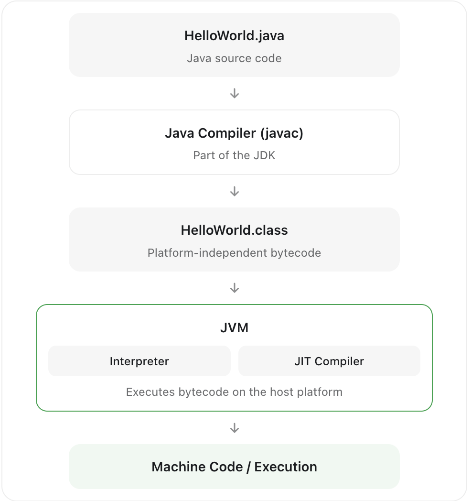
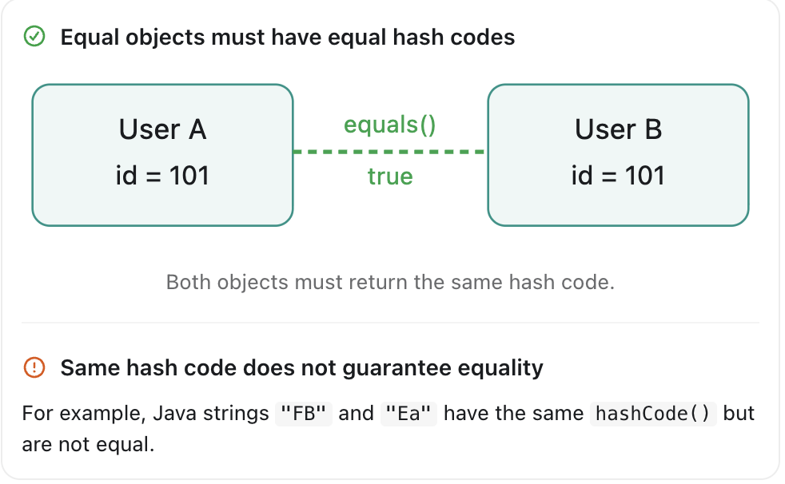
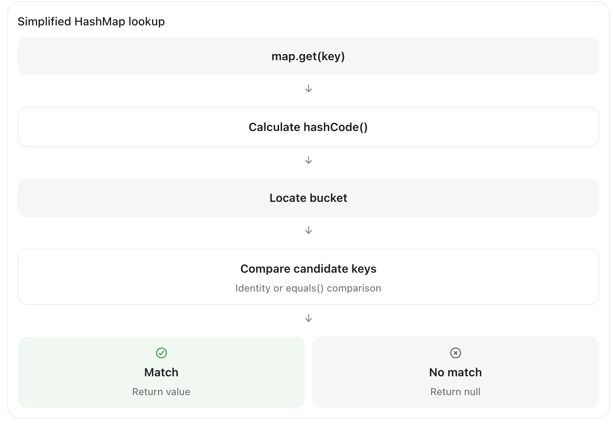
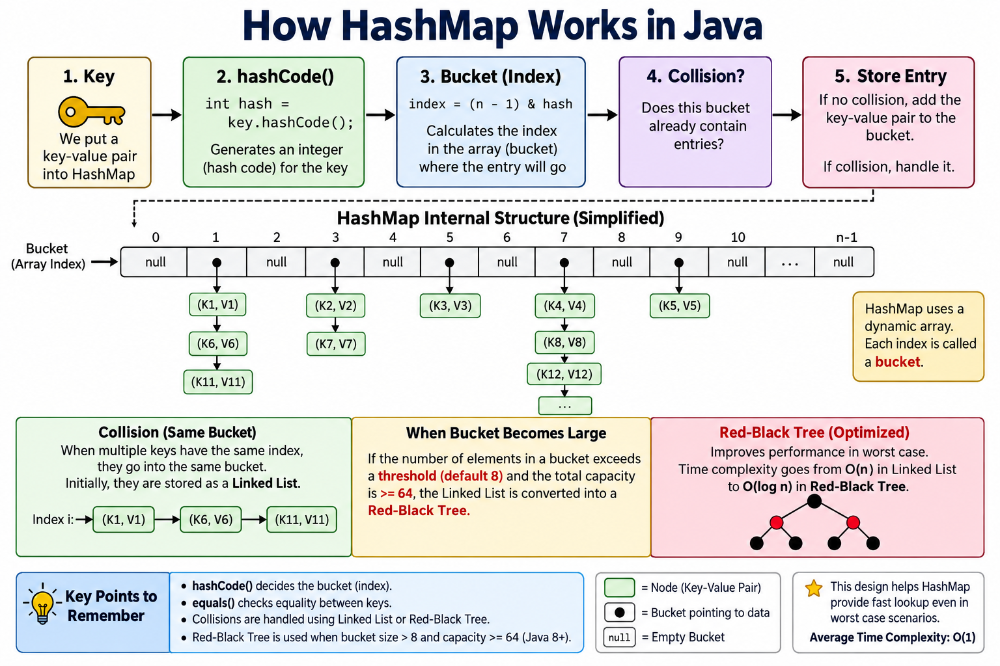
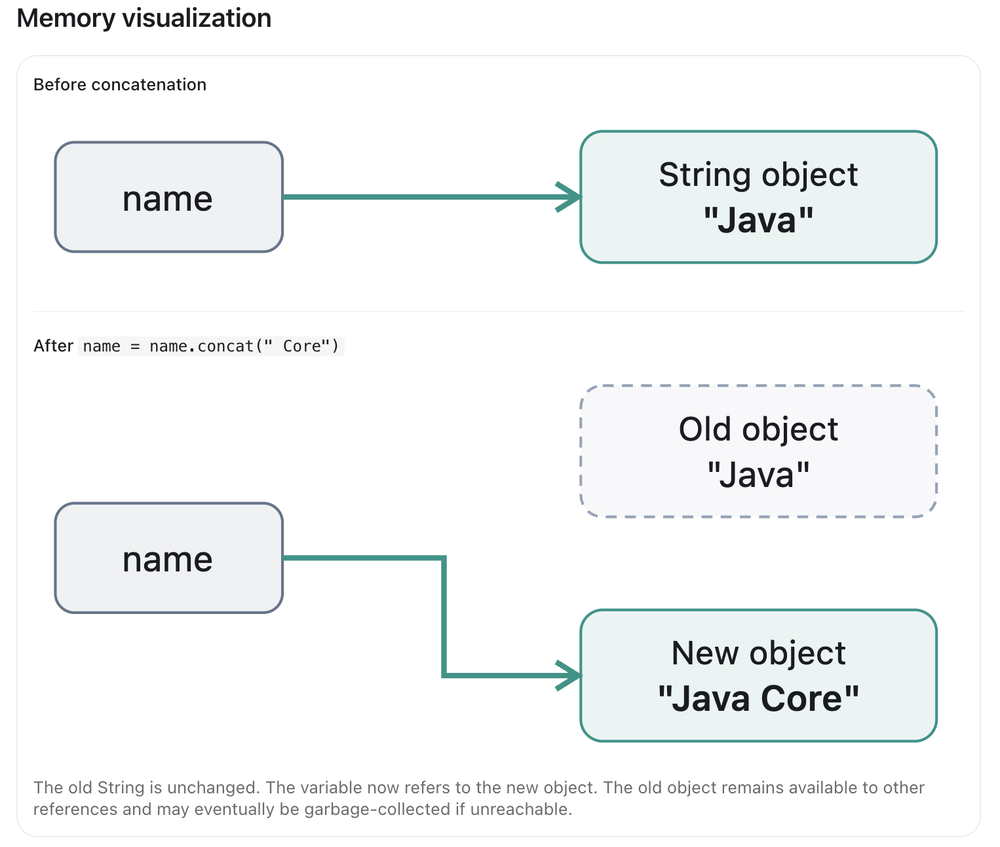
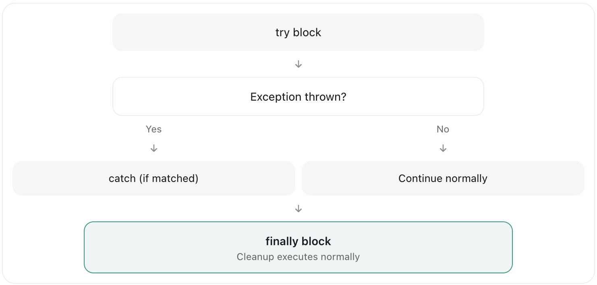
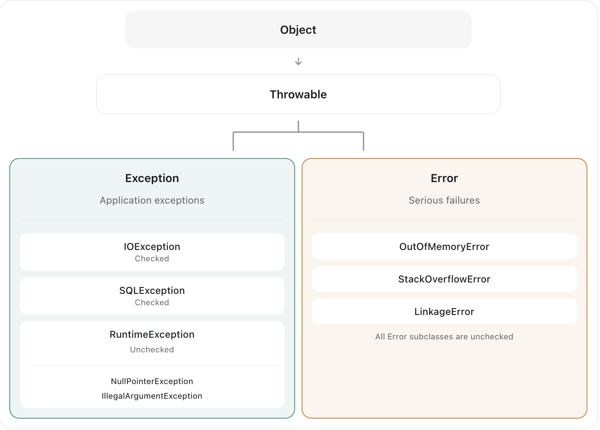
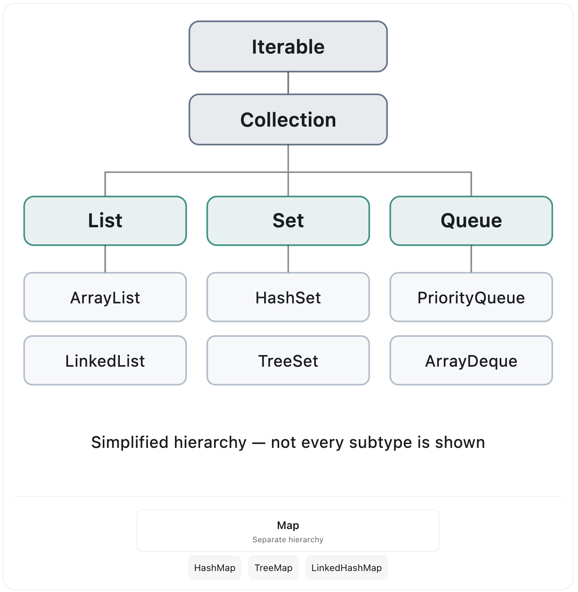
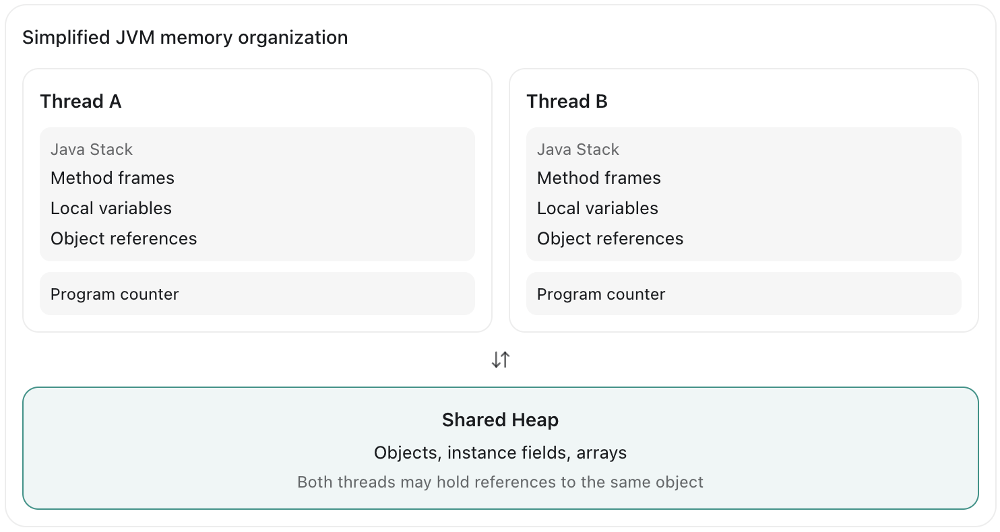

# Core Java Concepts

## JDK, JRE, and JVM

### JDK (Java Development Kit)
- The JDK is a superset of the JRE that includes development tools like compilers, debuggers, and profilers.
- It is used for developing, testing, and debugging Java applications.

### JRE (Java Runtime Environment)
- The JRE is a subset of the JDK that includes the Java Virtual Machine (JVM) and the core Java class libraries.
- It is used for running Java applications.

### JVM (Java Virtual Machine)
- The JVM is an abstract machine that provides a runtime environment for executing Java bytecode. It provides runtime memory management, garbage collection, class loading, and execution through interpretation and JIT compilation.
- It is responsible for loading, verifying, and executing Java bytecode.




## Object design and SOLID

### Object-Oriented Principles

**Encapsulation** means combining data and related behavior inside a class while controlling access to the internal state. For example, a `BankAccount` can keep its balance private and provide `deposit()` and `withdraw()` methods that enforce business rules.

**Abstraction** means exposing essential behavior while hiding implementation details. For example, a `PaymentService` interface can define a `pay()` method without exposing how credit-card or bank-transfer payments are processed.

**Polymorphism** allows different implementations to be used through a common type. For example, both `CreditCardPayment` and `BankTransferPayment` can implement the `PaymentService` interface, and the application can invoke `pay()` without knowing the concrete implementation.

**Inheritance** allows a subclass to reuse and extend the behavior of a parent class. For example, `SavingsAccount` can extend `BankAccount`. However, inheritance should represent a genuine "is-a" relationship, not just code reuse.

#### Model interview answer

??? "Sample answer"
    Object-Oriented Programming has four main principles: encapsulation, abstraction, inheritance, and polymorphism.

    First, encapsulation protects an object's internal state by restricting direct access and exposing controlled methods. For example, a BankAccount class should provide deposit and withdraw methods rather than exposing its balance directly.

    Second, abstraction hides implementation details and exposes essential behavior through interfaces or abstract classes. For example, a PaymentProcessor interface allows different payment implementations without changing the client code.

    Third, inheritance allows a subclass to reuse and extend behavior from a superclass. However, I prefer composition when there is no clear IS-A relationship because it reduces coupling.

    Finally, polymorphism allows the same method call to behave differently based on the implementation. Java supports method overloading and method overriding.

    Together, these principles help us build reusable, maintainable, and extensible applications.

### SOLID Principles

**SOLID** are five fundamental principles of object-oriented design and programming.

#### SRP - Single Responsibility Principle

- Definition: A class should have only one reason to change, meaning it should focus on a single job or responsibility.
- Impact: Reduces coupling and makes code more maintainable.

??? "Example"
    ```java
    // Bad example, UserHandler has multiple responsibilities
    // It handles user data and also database operations and email sending
    public class UserHandler {
        private String name;
        private String email;
        
        public void saveToDatabase() {
            // Database logic
        }
        
        public void sendEmail() {
            // Email logic
        }
    }

    // Good example, User only handles user data
    // Database operations and email sending are handled by separate classes
    public class User {
        private String name;
        private String email;
    }

    public class UserRepository {
        public void save(User user) {
            // Database logic
        }
    }

    public class EmailService {
        public void send(User user) {
            // Email logic
        }
    }
    ```

#### OCP - Open/Closed Principle

- Definition: Protects stable policy with extension points. It means that classes should be open for extension but closed for modification.
- Impact: Makes code more maintainable and extensible.

??? "Example"
    ```java
    // Bad example, PaymentProcessor has multiple responsibilities
    // It handles different payment methods and also logging
    public class PaymentProcessor {
        public void processPayment(PaymentMethod method, double amount) {
            // Payment logic
            System.out.println("Processing payment of " + amount);
        }
        
        public void logPayment(PaymentMethod method, double amount) {
            // Logging logic
            System.out.println("Logged payment of " + amount);
        }
    }

    // Good example, PaymentProcessor only handles payment processing
    // Logging is handled by a separate class
    public class PaymentProcessor {
        public void processPayment(PaymentMethod method, double amount) {
            // Payment logic
            System.out.println("Processing payment of " + amount);
        }
    }

    public class PaymentLogger {
        public void logPayment(PaymentMethod method, double amount) {
            // Logging logic
            System.out.println("Logged payment of " + amount);
        }
    }
    ```

#### LSP - Liskov Substitution Principle

- Definition: Demands substitutability. It means that objects of a superclass should be replaceable with objects of its subclasses without breaking the application.
- Impact: Ensures that subclasses can be used interchangeably with their base classes.

??? "Example"
    ```java
    // Bad example, Rectangle and Square don't follow LSP
    // Square breaks the contract of Rectangle
    public class Rectangle {
        protected int width;
        protected int height;
        
        public void setWidth(int width) {
            this.width = width;
        }
        
        public void setHeight(int height) {
            this.height = height;
        }
        
        public int getArea() {
            return width * height;
        }
    }
    
    public class Square extends Rectangle {
        public Square(int side) {
            super(side, side);
        }
        
        @Override
        public void setWidth(int width) {
            this.width = width;
            this.height = width; // This breaks the contract of Rectangle
        }
        
        @Override
        public void setHeight(int height) {
            this.width = height;
            this.height = height; // This breaks the contract of Rectangle
        }
    }

    // Good example, Rectangle and Square follow LSP
    // Both have the same contract and can be used interchangeably
    public abstract class Shape {
        public abstract int getArea();
    }
    
    public class Rectangle extends Shape {
        private int width;
        private int height;
        
        public Rectangle(int width, int height) {
            this.width = width;
            this.height = height;
        }
        
        @Override
        public int getArea() {
            return width * height;
        }
    }
    
    public class Square extends Shape {
        private int side;
        
        public Square(int side) {
            this.side = side;
        }
        
        @Override
        public int getArea() {
            return side * side;
        }
    }
    ```

#### ISP - Interface Segregation Principle

- Definition: Avoids forcing unused capabilities. It means that clients should not be forced to depend on interfaces they don't use.
- Impact: Makes code more maintainable and extensible.

??? "Example"
    ```java
    // Bad example
    public interface Worker {
        void work();
        void feed();
    }
    
    public class Robot implements Worker {
        @Override
        public void work() {
            System.out.println("Robot is working");
        }
        
        @Override
        public void feed() {
            // Robot doesn't need to feed, but it has to implement this method
            throw new UnsupportedOperationException("Robot doesn't need to feed");
        }
    }

    // Good example
    public interface Workable {
        void work();
    }
    
    public interface Feedable {
        void feed();
    }

    public class Robot implements Workable {
        @Override
        public void work() {
            System.out.println("Robot is working");
        }
    }
    
    public class Human implements Workable, Feedable {
        @Override
        public void work() {
            System.out.println("Human is working");
        }
        
        @Override
        public void feed() {
            System.out.println("Human is feeding");
        }
    }
    ```

#### DIP - Dependency Inversion Principle

- Definition: Points policy toward abstractions. It means that high-level modules should not depend on low-level modules. Both should depend on abstractions.
- Impact: Makes code more maintainable and extensible.

??? "Example"
    ```java
    // Bad example
    public class Car {
        private Engine engine = new V8Engine(); // Tight coupling
        
        public Car() {
        }
    }
    
    // Good example
    public interface Engine {
        void start();
    }
    public class Car {
        private final Engine engine; // Depends on abstraction
        
        public Car(Engine engine) { // Dependency injection
            this.engine = engine;
        }
    }
    ```

Too many tiny interfaces can be as costly as a god class.

## Equality, hashing and ordering

- `==` compares primitive values or reference identity.
- `equals` defines logical equality. It must be
reflexive, symmetric, transitive, consistent and false for null. 

??? "Example"
    ```java
    String s1 = "hello";
    String s2 = "hello";
    System.out.println(s1 == s2); // true (string pool)
    System.out.println(s1.equals(s2)); // true

    String s3 = new String("hello");
    String s4 = new String("hello");
    System.out.println(s3 == s4); // false (different objects)
    System.out.println(s3.equals(s4)); // true (same content)

    String s5 = "hello";
    String s6 = new String("hello");
    System.out.println(s5 == s6); // false (different objects)
    System.out.println(s5.equals(s6)); // true (same content)
    ```

- Equal objects must have equal hash codes; unequal objects may collide. Equality/hash state used as a HashMap key must not change while stored.
- `Comparable` defines a type's natural order; `Comparator` defines external orders. A sorted set uses
comparison equality (`compare == 0`) for uniqueness, so inconsistency with `equals` can surprise
callers even though Java permits it.

??? "Example"
    ```java
    public class Person implements Comparable<Person> {
        private final String name;
        private final int age;
        
        public Person(String name, int age) {
            this.name = name;
            this.age = age;
        }
        
        @Override
        public boolean equals(Object obj) {
            if (this == obj) return true;
            if (obj == null || getClass() != obj.getClass()) return false;
            Person person = (Person) obj;
            return age == person.age && Objects.equals(name, person.name);
        }
        
        @Override
        public int hashCode() {
            return Objects.hash(name, age);
        }
        
        @Override
        public int compareTo(Person other) {
            int nameCompare = name.compareTo(other.name);
            if (nameCompare != 0) return nameCompare;
            return Integer.compare(age, other.age);
        }
    }
    ```
### The contract between `equals` and `hashCode`
- If two objects are equal according to `equals()`, they must have the same hash code.
- If two objects are not equal according to `equals()`, they may or may not have the same hash code.
- If two objects have the same hash code, they are not necessarily equal. Hash collision are allowed.
- If an object's equality-related state doesn't change, its hash code should remain consistent during execution.



### How HashMap uses equals and hashCode



In a typical HashMap lookup:

1. The key's `hashCode()` is called to determine the bucket index.
2. If multiple keys hash to the same bucket (hash collision), the map uses `equals()` to find the exact key.

The constructor of a HashMap is an array of buckets, where each bucket is a linked list or tree.

From java 8, when a bucket reachs at least 8 elements and array size is equals or greater than 64, the bucket is converted to a tree.



### Model interview answer

??? "Sample answer"
    In Java, ==, equals(), and hashCode() serve different purposes.

    The == operator compares values for primitive types and reference identity for objects.

    The equals() method is used to check logical equality. By default, it behaves like reference comparison, but classes such as String override it to compare their contents.

    The hashCode() method generates an integer hash value used by hash-based collections such as HashMap and HashSet.

    The important contract is that if two objects are equal according to equals(), they must return the same hash code. However, two objects with the same hash code are not necessarily equal because hash collisions are possible.

    Therefore, whenever I override equals(), I also override hashCode() using the same equality-defining fields. Otherwise, hash-based collections may behave incorrectly.

    I also avoid modifying fields involved in equality while an object is stored as a key in a HashMap.

## Immutability and Java 21 data types

An immutable object has stable observable state: final references are insufficient if they point to
mutable collections. Copy mutable inputs and outputs. Records provide final components and value
semantics but are only shallowly immutable. Enums model a closed set of instances; sealed classes
model a closed hierarchy with variant-specific state. Java 21 pattern matching makes exhaustive
`switch` over sealed hierarchies practical.

## String, String Builders, and String Buffer

All three classes represent sequences of characters, but they differ in mutability, thread safety, and performance.

User `String` by default. Use `StringBuilder` for single-threaded mutable string building. Use `StringBuffer` only when its synchronized, thread safety is required.

### String - Immutable

A String object cannot be modified after creation

Any operation that appears to change a String produces another String value rather than modifying the existing object.



#### Why is String immutable?

- Security: String values cannot be changed through and existing reference after creation.
- Thread safety: Immutable String objects can safely be shared between threads without synchronization.
- String pooling: Identical literals can share the same object.
- Hasing: A String's hash code remains stable, making it suitable as a HashMap key.

### StringBuilder - Mutable, not thread-safe

`StringBuilder` maintains a mutable character sequence.

Instead of creating a new String for each modification, it generally modifies its internal buffer, expanding capacity when necessary.

`StringBuilder` is generally the preferred option for building strings inside loops or when many modifications are needed. All the operations on `StringBuilder` are not thread-safe.

### StringBuffer - Mutable, thread-safe

`StringBuffer` is similar to `StringBuilder` but is thread-safe. All the operations on `StringBuffer` are thread-safe, which means it is slower than `StringBuilder` but can be used in multi-threaded environments.

!!! note "Consider using"
    Although `StringBuilder` and `StringBuffer` are good for concatenating strings, which doesn't mean `String` concatenation is always slow. For simple concatenation expressions, modern Java compilers and the JVM can optimize string concatenation efficiently. Use `StringBuilder` when repeated accumulation make it useful, not automatically for every `+` operation.

### Model Interview Answer

??? "Model Answer"
    String, StringBuilder, and StringBuffer all represent sequences of characters, but they differ in mutability and thread safety.

    String is immutable, so once a String object is created, its content cannot change. Any modification produces a new String value. This makes it safe to share across threads and useful as a HashMap key.

    StringBuilder is mutable and not thread-safe. It allows efficient modifications through methods like append, insert, and delete. I normally use it when constructing dynamic strings, especially inside loops.

    StringBuffer is also mutable, but its methods are synchronized, which provides thread safety for individual operations. This synchronization can introduce additional overhead.

    In practice, I use String by default, StringBuilder for repeated modifications in a single-threaded context, and StringBuffer only when I specifically need synchronized access to a shared mutable character sequence.

    I also understand that modern Java optimizes simple String concatenation, so using StringBuilder is not always necessary.

## final, finally, and finalize

The most important distinction is that `final` is a modifier, `finally` is a part of exceptioin handling, and `finalize` is a deprecated method.

### final - Restrict modification

In Java, `final` can be applied to variables, methods, and classes.

- **Variables**: a `final` variable can only be assigned once. After that, its value/reference cannot be changed.
- **Methods**: a `final` method cannot be overridden by any subclasses.
- **Classes**: a `final` class cannot be extended by any subclasses.

### finally - Exception handling and cleanup

The `finally` block is used with `try` and optionally `catch` blocks.

It is executed regardless of whether an exception is thrown or not.



!!! info "Note"
    Should not return a value from a finally block, as it can mask exceptions from the try block, which can override the return value of the try block.

    For morden Java, I recommend using try-with-resources instead of try-finally for resource management.

### finalize - Object cleanup (deprecated)

`finalize` is a method that is called by the garbage collector before an object is destroyed. It is used to perform cleanup operations.

Since `finalize` is deprecated, I recommend using try-with-resources instead of relying on `finalize` for resource management.

To make the try-with-resources work, the resource must implement the `AutoCloseable` interface.

### Model Interview Answer

??? "Model Answer"
    In Java, final, finally, and finalize serve three different purposes.

    First, final is a modifier. When applied to a variable, it prevents reassignment. When applied to a method, it prevents overriding. When applied to a class, it prevents inheritance. However, a final reference does not necessarily make the referenced object immutable.

    Second, finally is used in exception handling. It normally executes after try and catch, even when an exception occurs or the method returns. It is useful for cleanup, although try-with-resources is preferred for managing AutoCloseable resources.

    Finally, finalize is a legacy method associated with garbage collection. It was designed for cleanup before an object is reclaimed, but its execution is not guaranteed. Since it is deprecated for removal, I would avoid it in modern Java and use AutoCloseable or Cleaner when appropriate.

    The key difference is that final restricts changes, finally controls cleanup execution, and finalize is an obsolete object cleanup mechanism.

## Interface and Abstract Class

Both interfaces and abstract classes support abstraction, but they serve different design purposes.

Java allows to implement multiple interfaces in a class, but only extends one abstract class.

### Interface

An interface defines a contract that implementing classes must follow. It is useful when multiple classes need to provide the same behavior but may have different implementations.

#### Java 8+ Features

##### Default Methods

Interfaces can provide a default implementation for methods. This is especially useful when evoling an existing interface without forcing every implementation to immediately implement a new method.

When two interfaces provide default methods with the same signature, the implementing class must override the method to resolve the conflict.

##### Static Methods

Interfaces can provide static methods, which are utility methods that belong to the interface itself rather than to any instance.

#### Private Methods - Java 9+

Interfaces can provide private methods, which are helper methods that can be used by other methods in the interface but are not part of the public contract.

### Abstract Class

An abstract class provides a common base for related classes. It can contain instance fields, constructors, concrete methods, and abstract methods.

**Design Principle**: Prefer interfaces for contracts, and prefer composition over inheritance when code reuse does not represent a genuine "is-a" relationship.

An interface is not automatically better than an abstract class. The choice depends on the relationship between the types and the responsibilities they share.

### Model Interview Answer

??? "Model Answer"
    Both interfaces and abstract classes support abstraction in Java, but they have different purposes.

    An interface defines a contract that implementing classes must follow. It is useful for loose coupling and polymorphism, especially when unrelated classes need to provide the same capability. A class can implement multiple interfaces.

    An abstract class provides a common base for related subclasses. It can contain instance fields, constructors, concrete methods, and abstract methods. However, Java only allows a class to extend one superclass.

    Since Java 8, interfaces can also have default and static methods, and since Java 9, they can have private methods. However, interfaces still cannot maintain per-instance state like abstract classes.

    In practice, I prefer interfaces for defining contracts, such as PaymentProcessor, and abstract classes when closely related subclasses share meaningful state or implementation, such as different types of BankAccount.

    I also consider composition when the goal is simply to reuse behavior without creating a strong inheritance relationship.

### Key Differences

- **Inheritance**: A class can implement multiple interfaces but can only extend one abstract class.
- **Method Implementation**: An interface can only have abstract methods (before Java 8), while an abstract class can have both abstract and non-abstract methods.
- **Variables**: An interface can only have static final variables, while an abstract class can have instance variables.
- **Access Modifiers**: An interface can only have public methods, while an abstract class can have various access modifiers.

## Exceptions and resources

An exception is an event that disrupts the normal execution flow of a program.

Java provides two main categories of exceptions:

- Checked exceptions: These are exceptions that are checked at compile time. They are usually used to indicate that an error has occurred that the program should be able to recover from.
- Unchecked exceptions: These are exceptions that are not checked at compile time. They are usually used to indicate that an error has occurred that the program should not be able to recover from.



`Error` generally represents serious conditions that ordinary application code is not expected to recover from. It is not a subclass of `Exception`

### Checked Exceptions

Checked exceptions are exceptions that compiler requires us to catch or declare using throws. They usually represent failures that callers may be able to recover from.

Use checked exceptions when the caller can reasonably be expected to handle a failure as part of normal application behavior.

Examples include reading file, accessing an external resource, or parsing data with a documented recoverable failure.

The caller has two options to handle `checked` exceptions:

- Catch and handle the exception

```java
try {
    // code that may throw checked exception
} catch (Exception e) {
    // handle exception
}
```

- Declare the exception using `throws` in the method signature, that propagates the exception to the caller

```java
public void method() throws Exception {
    // code that may throw checked exception
}
```

### Unchecked Exceptions

Unchecked exceptions inherit from RuntimeException or Error.

Unchecked exceptions are not enforced by the compiler. They usually extend RuntimeException and can represent invalid arguments, illegal states, or application-specific failures.

However, not every unchecked exception is a programming bug. Applications frequently use custom unchecked exceptions to represent business failures.

### Best practises for exception handling

#### Catching Specific Exceptions

Avoid catching overly broad exceptions unless you are implementing an intentional application boundary.

**Bad practice:**
```java
try {
    readFile();
} catch (Exception e) {
    System.out.println("Something went wrong");
}
```

**Better practice:**
```java
try {
    readFile();
} catch (FileNotFoundException e) {
    System.out.println("File not found");
} catch (IOException e) {
    System.out.println("IO error occurred");
}
```

The catch block now handles a known failure type and preserves the exception.

However, if the method has no useful information to add, it is even better to let the exception propagate without catching it.

#### Never Silently Swallow Exceptions

A swallowed exception occurs when a catch block ignore the failure.

**Bad practice:**
```java
try {
    processPayment();
} catch (PaymentException e) {
    // Ignore
}
```

This is dangerous because the caller may assume the payment succeeded.

A better approach is to propagate the exception or return an explicit failure results, depending on the method's contract.

**Better practice:**
```java
try {
    processPayment();
} catch (PaymentException e) {
    throw new OrderProcessingException(
        "Payment processing failed", e
    );
}
```

This allows the higher layer to decide how to respond.

#### Preserve the original cause

When translating an exception into another exception type, preserve the original cause.

**Bad practice:**
```java
try {
    processPayment();
} catch (PaymentException e) {
    throw new OrderProcessingException("Payment processing failed");
}
```

**Better practice:**
```java
try {
    processPayment();
} catch (PaymentException e) {
    throw new OrderProcessingException("Payment processing failed", e);
}
```

Your custom exception should support cause chaining:

```java
public class OrderProcessingException extends Exception {
    public OrderProcessingException(String message, Throwable cause) {
        super(message, cause);
    }
}
```

This preserves the original stack trace and makes troubleshooting much easier.

#### Handle exceptioins at the appropriate layer

One important production nuance: a method should handle exceptions at the layer where it can meaningfully respond to them. For example, a data access method should not catch database exceptions and convert them to business exceptions, as it does not know how the caller should respond to a database failure.

- Controller: Handle application-level exceptions and return appropriate HTTP responses.
- Service: Handle business logic exceptions and coordinate between layers.
- Repository: Handle data access exceptions and propagate them to the service layer.

```java
@Controller
public class OrderController {
    @PostMapping("/orders")
    public ResponseEntity<?> createOrder(@RequestBody OrderRequest request) {
        try {
            orderService.placeOrder(request);
            return ResponseEntity.ok("Order created successfully");
        } catch (InvalidOrderException e) {
            return ResponseEntity.badRequest().body(e.getMessage());
        } catch (OrderProcessingException e) {
            return ResponseEntity.status(HttpStatus.INTERNAL_SERVER_ERROR).body("Order processing failed");
        }
    }
}

@Service
class OrderService {
    private final PaymentGateway paymentGateway;

    OrderService(PaymentGateway paymentGateway) {
        this.paymentGateway = paymentGateway;
    }

    public void placeOrder(OrderRequest request) {
        if (request.items().isEmpty()) {
            throw new InvalidOrderException(
                "Order must contain items"
            );
        }

        try {
            paymentGateway.charge(request);
        } catch (PaymentGatewayException e) {
            throw new OrderProcessingException(
                "Unable to process order payment", e
            );
        }
    }
}

```

#### Log once at the appropriate boundary

A common anti-pattern is logging and rethrowing the same exception at every layer.

**Bad Practise**
```java
catch (IOException e) {
    logger.error("Failed to read data", e);
    throw new DataAccessException("Failed", e);
}
```

**Good Practise**
```java
// At the lower layer
catch (IOException e) {
    throw new DataAccessException(
        "Unable to load customer data", e
    );
}

// At the application boundary (controller/service)
catch (DataAccessException e) {
    logger.error(
        "Customer request failed, requestId={}",
        requestId,
        e
    );
}
```

!!! info "Key Takeaways"
    Prefer logging exceptions at a boundary where you have sufficient context and decide the final outcome. Intermediate layers should generally propagate or translate exceptions without duplicating logs.

#### Use try-with-resources for resource cleanup

Use try-with-resources for objects implementing `AutoCloseable` to ensure proper resource management and cleanup.

```java

public String readFile(Path path) throws IOException {
    try (BufferedReader reader =
             Files.newBufferedReader(path)) {

        return reader.readLine();
    }
}
```

#### Handle `InterruptedException` correctly

This is particularly important for multithreaded Java applications. When you cannot propagate the checked exception, you should restore the thread's interrupt status by calling `Thread.currentThread().interrupt()` so higher level code can observe it. Returning also stops the current operation.

When an exception `InterruptedException` happens, the `Thread.currentThread().isInterrupted()` status changes to `true`. However, when catching `InterruptedException`, the JVM automatically clears the interrupt status (resets it from `true` to `false`). 

If your method can declare `throws InterruptedException`, do so instead of catching it.

```java
try {
    Thread.sleep(1000);
} catch (InterruptedException e) {
    Thread.currentThread().interrupt();
    return;
}
```

#### Don't use exceptions for normal control flow

Use return values to represent expected outcomes. Use exceptions to represent failures that prevent an operation from fulfilling its contract.

**Normal Control Flow** represents expected pahts through an application, such as:

- A user exists or doesn't exist when searching
- A product matches or doesn't match a filter.
- A queue has an item or is empty.
- A validation succeeds or fails.
- A customer qualifies or doesn't qualify for a promotion.

These outcomes aren't necessarily application failures.

**Bad Example**: Using an exception to find a user.

```java
public User findUser(long id) {
    try {
        return repository.getById(id);
    } catch (UserNotFoundException e) {
        return null;
    }
}
```

This approach has several problems.

First, it treats a potentially expected absence as an exceptional event.

Second, the caller receives `null` without a clear contract.

Third, creating exceptions and collecting stack traces can introduce unnessary overhead, especially in frequently executed paths.

Also, this example assumes `getById()` immediatelly throws when the user is missing; not every repository API behaves that way.

**Better Example**: Use `Optional`

```java
public Optional<User> findUser(long id) {
    return repository.findById(id);
}

// Caller
Optional<User> result = findUser(100);

if (result.isPresent()) {
    System.out.println(result.get().getName());
} else {
    System.out.println("User not found");
}

// Or even cleaner
findUser(100)
    .ifPresentOrElse(
        user -> System.out.println(user.getName()),
        () -> System.out.println("User not found")
    );

```

The exceptions are not ideal for expected branches because:

- Exceptions can obscure business logic

```java
// Bad: Exception-driven flow
try {
    applyDiscount(customer);
} catch (NotEligibleException e) {
    return originalPrice;
}

// Good: Explicit conditional flow

if (discountPolicy.isEligible(customer)) {
    return applyDiscount(customer);
}

return originalPrice;
```

- Exceptions can have additional runtime cost: Constructing an exception typically captures stack-trace information, which can be more expensive than a simple conditional or return value. However, don't assume exceptions are always a measurable performance problem. JVM optimizations, exception construction, and the frequency of the failure path all matter. Measure before making performance claims.

- Exceptions make contracts harder to understand
- Exception handling can become accidental control flow

##### Alternatives

- Use `boolean` for simple decisions
- Use `Optional` for expected absence
- Use `Result` or `Either` for error handling
- Use Sealed result types

A simple result object can represent success and failure, but it may allow invalid combinations of fields.

For example, `valid = true` while `errorCode=INVALID_EMAIL`

Sealed types provide stronger modeling

```java
sealed interface RegistrationResult
        permits RegistrationResult.Success,
                RegistrationResult.InvalidEmail,
                RegistrationResult.AlreadyExists {

    record Success(long userId)
            implements RegistrationResult {}

    record InvalidEmail(String reason)
            implements RegistrationResult {}

    record AlreadyExists(String email)
            implements RegistrationResult {}
}
```

Now the possible outcomes are explicitly represented as different types.

```java
public RegistrationResult register(String email) {
    if (email == null || !email.contains("@")) {
        return new RegistrationResult.InvalidEmail(
            "Invalid email format"
        );
    }

    if (repository.existsByEmail(email)) {
        return new RegistrationResult.AlreadyExists(email);
    }

    User user = repository.save(new User(email));

    return new RegistrationResult.Success(user.getId());
}
```

The caller can handle each result using Java 21 pattern matching for `switch`

```java
RegistrationResult result = register(email);

String message = switch (result) {
    case RegistrationResult.Success s ->
        "Created user " + s.userId();

    case RegistrationResult.InvalidEmail e ->
        "Validation failed: " + e.reason();

    case RegistrationResult.AlreadyExists e ->
        "Already registered: " + e.email();
};
```

The compiler can check whether the switch covers all permitted result types. This is a major advantage when modeling multiple expected outcomes.

**Important distinction between Business rejection vs Infrastructure failure**

Consider a bank transfer:

```java
sealed interface TransferResult {
    record Success(String transferId)
            implements TransferResult {}

    record InsufficientFunds()
            implements TransferResult {}

    record LimitExceeded()
            implements TransferResult {}
}
```

Think of it this way:

- **Business rejections** (like `InsufficientFunds` or `LimitExceeded`) are expected outcomes that the application should handle gracefully.
- **Infrastructure failures** (like network timeouts or database connection issues) are exceptional conditions that should be propagated as exceptions.

Therefore, a database outage should not return `InsufficientFunds`, `false`, or `Optional.empty()`. That would falsely communicate a business outcome.

Also, a timeout after submitting a transfer can mean the outcome is unknown, not necessarily failed. It may require a separate pending or unknown state and reconcilation.

##### Code review

```java
public boolean transfer(
        long fromAccount,
        long toAccount,
        BigDecimal amount) {

    try {
        accountService.withdraw(fromAccount, amount);
        accountService.deposit(toAccount, amount);
        return true;

    } catch (InsufficientFundsException e) {
        return false;

    } catch (Exception e) {
        return false;
    }
}
```

??? "What's wrong with this code?"
    The problems are that false loses the reason for failure, broad exception handling hides infrastructure errors, and the withdrawal might succeed while the deposit fails.

    I would model expected business rejections with a TransferResult, propagate unexpected technical failures, and ensure both balance changes happen atomically within a database transaction when they share the same transactional database.

    If accounts are managed by separate services, a single local database transaction is insufficient. I would design an explicit distributed workflow with durable state, idempotency, and recovery or compensation.

    Key insight: Choosing a return type is only one part of error handling. Correctness also depends on transactional boundaries and failure recovery.

```java
public void processOrder(Order order) {
    try {
        paymentGateway.charge(order);
        orderRepository.save(order);
    } catch (Exception e) {
        logger.error("Order failed", e);
        throw new RuntimeException(e);
    }
}
```


??? "What's wrong with this code?"
    Key improvements

    1. Catch known payment or persistence exceptions rather than every Exception.
    2. Preserve the original cause and use meaningful exception types.
    3. Avoid duplicate logging if the boundary already logs the failure.
    4. Do not assume a failed order means payment was unsuccessful.
    5. Persist order/payment state and use an appropriate recovery workflow, such as reconciliation, idempotent retries, or a Saga with compensation.

    **Important**: Adding @Transactional alone would not solve the problem because a database transaction cannot automatically roll back an external payment.

#### Avoid exposing sensitive information

Exposing sensitive data—such as internal server file paths, IP addresses, database schemas, PII (Personally Identifiable Information), or encryption keys—via exception logs or error responses is a major security vulnerability known as Information Disclosure.

Here is how to properly manage exceptions while keeping your application secure:

##### Never Leak Details to the End User or Client

An attacker can intentionally trigger exceptions (e.g sending bad input to cause timeouts or interrupts) to map out your infrastructure. Always map internal exceptions to clean, generic user-facing messages.

```java
// Bad: Exposing technical stack and internal details to the API response
@GetMapping("/process")
public ResponseEntity<String> process() {
    try {
        taskService.execute();
        return ResponeEntity.ok("Success");
    } catch (Exception e) {
        return ResponseEntity.status(500).body("Error: Thread " + Thread.currentThread().getName() + " was interrupted. Stack: " + e.getMessage());
    }
}

// Good: Return a generic message to the user, log the details securely inside the server
@GetMapping("/process")
public ResponseEntity<String> process() {
    try {
        taskService.execute();
        return ResponeEntity.ok("Success");
    } catch (Exception e) {
        // Log the details securely (e.g., to a monitoring system)
        logger.error("Error processing task", e);
        return ResponseEntity.status(500).body("An unexpected error occurred. Please try again later.");
    }
}
```

##### Sanitize Server Logs (Prevent Log Injection & PII Leaks)

Even inside internal server logs, exposing raw parameters can violate compliance rules. If a thread gets interrupted while processing a specific user's transaction, do not dump the raw transaction details straight into the log message.

```java
// Bad: Exposing raw transaction details in logs
logger.error("Error processing transaction for user {}: {}", userId, transactionDetails);

// Good: Mask sensitive data in logs
logger.error("Error processing transaction for user {}: {}", userId, "MASKED");
```

##### Mask Stack Traces in Production

Ensure your application framework is configured to **disable stack traces** in HTTP error responses.

In your application.properties or application.yml file, always ensure production environments explicitly mask these details:

```text
server.error.include-stacktrace=never
server.error.include-message=never
```


### Common Java Errors

Represents serious failures, often involving the JVM or runtime environment.

There are some common Java Errors.

#### OutOfMemoryError

Occurs when the JVM cannot allocate the required memory.

```java
import java.util.ArrayList;
import java.util.List;

public class Main {
    public static void main(String[] args) {
        List<byte[]> data = new ArrayList<>();

        while (true) {
            data.add(new byte[1024 * 1024]);
        }
    }
}
```

This example deliberately retains large arrays until memory exhaustion. Do not run it in a normal application environment.

Typical causes include memory leaks, retaining too many objects, insufficient heap capacity, or excessive allocation.

Possible responses include investigating heap dumps, reviewing object retention, and adjusting memory limits where appropriate.

#### StackOverflowError

Occurs when a thread exhausts its stack, commonly due to excessive recursion.

```java
public class Main {
    static void recursive() {
        recursive();
    }

    public static void main(String[] args) {
        recursive();
    }
}
```

The method never reaches a termination condition.

A common solution is to fix the recursion logic or replace deep recursion with an iterative approach.

#### NoClassDefFoundError

Occurs when a class that was available at compilation or earlier resolution cannot be found or initialized when the JVM needs it.

Possible causes include a missing runtime dependency, incorrect classpath, or a previous claas initialization failure.

**Important distinction** `ClassNotFoundException` is a checked exception commonly associated with explicit class loading, while `NoClassDefFoundError` is an unchecked `Error` associated with class resolution or initialization.

### What should/shouldn't exception catched

- Catch exceptions that you can handle meaningfully
- Don't catch exceptions that you can't handle
- Don't catch exceptions that you don't understand
- Techincally, we can catch `Error` but it's not recommended. Catching an Error does not mean the application can safely recover.
- Don't catch `Throwable` directly, catch `Exception` or specific exception types. Because `Throwable` includes both `Error` and `Exception`.

In Java, both Exception and Error inherit from Throwable.

Exception represents conditions that an application may handle, such as IOException, SQLException, or IllegalArgumentException. Exceptions can be checked or unchecked.

Error represents serious failures, often related to the JVM, runtime environment, or class loading. Examples include OutOfMemoryError, StackOverflowError, and NoClassDefFoundError.

Although Java allows us to catch Error, we generally should not because the application may not be in a safe state to recover.

In production, I prefer catching specific exceptions, logging meaningful diagnostic information, and using monitoring and process recovery mechanisms for serious runtime failures.

## Optional

Optional is primarily a return type for expected absence. It is not a universal null replacement:
fields and parameters often create double absence, serialization friction and noisy calls. Prefer
`map`, `flatMap`, `filter`, `orElseGet` and contextual `orElseThrow`; avoid unproved `get()`.

## Collections

The Java Collections Framework is a standardized set of interfaces, implementations, and algorithms for storing and manipulating groups of objects.



The main interfaces include `List`, `Set`, `Queue`, `Deque`, and `Map`.

- `List` maintains an ordered sequence and allows duplicates.
- `Set` ensures uniqueness of elements.
- `Queue` and `Deque` support processing elements in different orders.
- `Map` associates keys with values.

Collection is the root interface for most collection types, while Collections is a utility class that provides algorithms such as sorting and searching. Map belongs to the framework but does not extend Collection.

Collection extends `Iterable` and defines common operations such as add, remove, contains, size, clear, and iterator.

Collection itself does not define indexed access or guarantee ordering. These behaviors depend on the subinterface and implementation.

In practice, I prefer programming to interfaces. If a method only needs general collection operations, I use Collection. If it requires indexed access, I use List. If it requires key-value pairs, I use Map. This reduces coupling to concrete implementations and makes the code easier to maintain.

### Removing while iterating

This is a common interview trap

```java
List<String> list = new ArrayList<>(Arrays.asList("a", "b", "c"));
for (String s : list) {
    if (s.equals("b")) {
        list.remove(s); // ConcurrentModificationException
    }
}

// Good
List<String> list = new ArrayList<>(Arrays.asList("a", "b", "c"));
list.removeIf(s -> s.equals("b"));

// Or through iterator
Iterator<String> iterator = list.iterator();
while (iterator.hasNext()) {
    String s = iterator.next();
    if (s.equals("b")) {
        iterator.remove();
    }
}
```

### List

`List<E>` extends `Collection<E>` and represents an ordered sequence of elements.

Its main characteristics are:

- Positional ordering: Each element has an index starting at 0.
- Duplicates allowed: Multiple elements can be equal.
- Indexed operations: Access, insert, replace, and remove elements by position.
- Null support: Many implementations allow null elements, but not all.
- Interation order: Iteration follows the list's positional order.

#### ArrayList internals

`ArrayList` is backed by a dynamically resized array. By default its capacity is 10, and it doubles when resized.

If there is available capacity, the new element is stored in the next slot.

When the array becomes full, the implementation allocates a larger array and copies the existing references.

This means:

- `get(index)` is O(1) because elements are stored in an array
- Appending is O(1) amortized
- Inserting or removing near the beginning requires shifting elements, making it O(n)

#### LinkedList internals

`LinkedList` is backed by a doubly-linked list. Each element is a node that contains a reference to the next and previous nodes.

This means:

- `get(index)` is O(n) because elements are stored in a linked list
- Appending is O(1)
- Inserting or removing requires traversing the list to find the position, making it O(n). However, inserting or removing the first or last element is O(1).

#### ArrayList vs LinkedList performance

LinkedList insertion is O(1) only when the position is already known, such as at the ends or though a positioned ListIterator.

Even when two operations have the same Big-O complexity, ArrayList often performs better because its references are stored contiguously, improving cache locality.

LinkedList requires following references between separate node objects and usually consumes more memory.

#### sublist()

`sublist(fromIndex, toIndex)` returns a view backed by the original list, not an independent copy.

```java

List<String> names =
    new ArrayList<>(List.of("A", "B", "C", "D"));

List<String> subset = names.subList(1, 3);

subset.set(0, "X");

System.out.println(names);
// [A, X, C, D]
```

Change through the view can affect the original list.

#### Mutable vs immutable vs unmodifiable lists

- Mutable lists can be modified after creation
- Immutable lists cannot be modified after creation
- Unmodifiable lists cannot be modified after creation. However, it is just only a wrapper, if original list mutable, and we change the original list, the unmodifiable list will also change.

```java

 List<String> mutableList = new ArrayList<>();
        mutableList.add("A");
        mutableList.add("B");
        System.out.println(mutableList); // [A, B]

        // 2. UNMODIFIABLE LIST (A wrapper view around the mutable list)
        List<String> unmodifiableList = Collections.unmodifiableList(mutableList);
        System.out.println(unmodifiableList); // [A, B]

        // 3. IMMUTABLE LIST (A true independent snapshot)
        List<String> immutableList = List.copyOf(mutableList);
        System.out.println(immutableList ); // [A, B]


        mutableList.add("C");
        // It will throw errors
        // unmodifiableList.add("D")
        System.out.println(unmodifiableList); // [A, B, C]

        // It will throw errors
        // immutableList.add("D")
        System.out.println(immutableList); // [A, B]

```

#### Choosing the right List

- Use `ArrayList` for indexed access, iteration, appending, and most general-purpose list operations.
- Use `LinkedList` when frequent insertions and removals happen through a positioned iterator or when its combined List and Deque functionality is genuinely needed.
- Use `ImmutableList` when you need an immutable snapshot that won't change
- Use `UnmodifiableList` when you need a read-only view of a mutable list
- Use `ArrayDeque` for most single-threaded queue or deque workloads, ArrayDeque ir preferable to LinkedList.
- Use specialized collections for concurrency like `ConcurrentHashMap`, `CopyOnWriteArrayList`, etc. Other workloads may need synchronization or different concurrent data structure.

### Set

`Set<E>` extends `Collection<E>` and represents a collection that does not contain duplicate elements.

Its main characteristics are:

- Uniqueness: A Set cannot contain two elements considered equal under its equality rules.
- No indexed access: Unlike List, it does not provide get(index).
- Ordering depends on implementation: Some sets are unordered, some preserve insertion order, and others sort elements.
- Null handling depends on implementation.
- Not inherently thread-safe.

Hash-based operations are not guaranteed constant-time in every case; collisions and resizing affect performance. TreeSet provides log-time performance for basic operations.

The Set<E> interface has several implementations:
- HashSet: Hash-based, no ordering, O(1) average performance. The internal implementation is HashMap.
- LinkedHashSet: Hash-based with insertion ordering, O(1) average performance. The internal implementation is LinkedHashMap. It's good to use when deduplicating data while preserving the order in which elements first appeared.
- TreeSet: Tree-based, sorted, O(log n) performance. The internal implementation is a TreeMap, which uses a self-balancing red-black tree. TreeSet is especially useful when you need sorted interation or navigation methods such as `first()`, `last()`, `floor()`, and `ceiling()`.

#### TreeSet: Comparable vs Comparator

TreeSet needs a way to order its elements

- `Comparable<T>` - Natural ordering defined by the element type itself

```java

record Product(long id, int price)
        implements Comparable<Product> {

    @Override
    public int compareTo(Product other) {
        int byPrice = Integer.compare(
            this.price, other.price
        );

        if (byPrice != 0) {
            return byPrice;
        }

        return Long.compare(this.id, other.id);
    }
}
```

Here, products are ordered by price, then ID

The ID tie-breaker is important. Without it, products with the same price would compare as 0, and TreeSet would treat them as duplicates.


- `Comparator<T>` - Custom ordering provided by the user

```java
Set<Product> products = new TreeSet<>(
    Comparator.comparingInt(Product::price)
              .thenComparingLong(Product::id)
);
```

This allows sorting without requirig the Product class to define natural ordering.

For TreeSet to fully obey the general Set equality contract, the ordering should be consistent with `equals()` 

#### Practical use cases

- HashSet: Fast membership checks use for checking whether a value has already been processed, deduplicating identifiers, or tracking visited nodes in algorithms.
- LinkedHashSet: Deduplication with order preservation, useful when you need both uniqueness and insertion order.
- TreeSet: Sorted deduplication with ordering, useful when you need both uniqueness and sorted iteration.

### Map

Map<K, V> represents a collection of key-value mappings.

Unlike List and Set, Map does not extend the Collection interface, although it is part of the Java Collections Framework.

Its main characteristics are:
- Unique keys: Each key maps to at most one value.
- Duplicate values allowed: Different keys may map to the same value.
- Lookup by key: Retrieve values using their associated keys.
- Ordering depends on implementation: Some maps are unordered, insertion-ordered, or sorted by key.
- Null handling depends on implementation.

Map<K, V> has several implementations:

- HashMap: Fast key-value lookups with no ordering guarantees.
- LinkedHashMap: Maintains insertion order or access order for predictable iteration.
- TreeMap: Keeps keys sorted by their natural order or a custom Comparator.

#### HashMap internals

HashMap uses a hash table consisting of buckets.

Each bucket can contain entries with the same bucket index.

In the Java 8+ implementation, treeification is attempted when insertion encounters an existing chain of at least 7 nodes, resulting in a bucket of at least nine nodes. If the table capacity is below 64, HashMap prefers resizing instead of treeifying


##### How put() works conceptually

1. Calculate the key's hashCode().
2. Spread the hash bits and calculate the bucket index.
3. Check whether an entry with an equal key already exists.
4. Replace the existing value if the key matches.
5. Otherwise, insert a new entry.
6. Resize the table when necessary.

##### How get() works conceptually

1. Calculate the key's hashCode().
2. Spread the hash bits and calculate the bucket index.
3. Traverse the bucket to find an entry with an equal key.
4. Return the associated value if found.
5. Return null if no matching key is found.

#### LinkedHashMap internals

LinkedHashMap extends HashMap and maintains a doubly linked sequence of entries.

This provides predictable iteration order.

##### How it works

- Each entry has links to the previous and next entries.
- The iteration order is determined by the order in which entries were inserted or accessed.
- When `accessOrder` is true, the most recently accessed entry is moved to the end.

#### TreeMap internals

TreeMap uses a red-black tree, a self-balancing binary search tree.

Keys are ordered using either natural ordering (Comparable) or a provided Comparator.

#### Thread-Safe Collections and ConcurrentHashMap Internals

A thread-safe collection makes its documented operations safe for concurrent use, but it does not automatically make every sequence of operations atomic.

| Collection | Thread safety approach | Best use case |
| --- | --- | --- |
| ConcurrentHashMap | CAS, volatile visibility, fine-grained synchronization | Concurrent key-value access |
| Collections.synchronizedMap() | Single wrapper mutex | Simple synchronized map access |
| CopyOnWriteArrayList | Copy backing array on mutation | Read-heavy lists |
| ConcurrentLinkedQueue | Non-blocking CAS-based queue | Unbounded concurrent FIFO |
| ArrayBlockingQueue | Lock-based bounded blocking queue | Producer-consumer workloads |
| LinkedBlockingQueue | Lock-based blocking queue | Producer-consumer workloads |
| ConcurrentSkipListMap | Concurrent ordered skip list | Sorted concurrent map |

##### ConcurrentHashMap internals

ConcurrentHashMap<K, V> is designed for concurrent reads and updates without locking the entire map for every operation.

In Java 8+, it uses an array of bins, similar in broad structure to HashMap.

A bin can contain a linked list or tree nodes.

###### How Java 8+ ConcurrentHashMap works

- Reads: get() normally retrieves entries without acquiring a lock, using volatile visibility and safe publication.
- Insertion into an empty bin: Can use compare-and-swap (CAS).
- Updates to an occupied bin: May synchronize on the bin's first node.
- Heavy collisions: Bins may be represented by tree nodes.
- Resizing: Multiple threads can cooperate in transferring entries to a larger table.

###### Why not lock the entire map?

Locking the whole map for every operation creates unnecessary contention when different threads access unrelated keys.

ConcurrentHashMap allows much more parallelism for many common workloads.

#### CAS(Compare-and-swap) vs synchronized

**CAS** is an atomic CPU-supported operation that conceptually does:

```java
if (expectedValue == currentValue) {
    // Atomically update currentValue to newValue
    currentValue = newValue;
    return true; // Success
} else {
    return false; // Failed - another thread modified the value
}
```
The comparison and update occur atomically, unlike an ordinary Java if statement.

CAS is useful when contention is relatively low and a short atomic update can succeed without acquiring a lock.

**synchronized** is a keyword that provides mutual exclusion by acquiring a lock on an object or class. It ensures that only one thread can execute a block of code or method at a time.

When updating an occupied bin, ConcurrentHashMap may synchronize on the bin's first node to coordinate modifications.

This prevents multiple threads from corrupting that bin's structure.

#### Atomic operations: compute, merge, putIfAbsent

Consider a counter stored in a ConcurrentHashMap.

Incorrect approach

```java
ConcurrentHashMap<String, Integer> counts =
    new ConcurrentHashMap<>();

counts.put("Java", 0);

// Not atomic as a combined operation:
counts.put("Java", counts.get("Java") + 1);
```


Each map method is individually thread-safe, but the overall read-modify-write sequence is not atomic.

**Correct approach A: compute()**

```java
ConcurrentHashMap<String, Integer> counts =
    new ConcurrentHashMap<>();

counts.put("Java", 0);

counts.compute("Java", (key, oldValue) ->
    oldValue == null ? 1 : oldValue + 1
);
```


The remapping operation is atomic for the specified key.

**Correct approach B: merge()**

```java
ConcurrentHashMap<String, Integer> counts =
    new ConcurrentHashMap<>();

counts.merge("Java", 1, Integer::sum);
counts.merge("Java", 1, Integer::sum);

System.out.println(counts.get("Java")); // 2
```


merge() is convenient for counters and aggregation.

**Correct approach C: LongAdder**

For frequently updated counters, use LongAdder.

```java
ConcurrentHashMap<String, LongAdder> counts =
    new ConcurrentHashMap<>();

counts.computeIfAbsent(
    "Java",
    key -> new LongAdder()
).increment();

long total = counts.get("Java").sum();
```


LongAdder distributes updates across internal cells under contention, reducing competition for a single variable.

However, sum() is not an atomic snapshot with respect to concurrent updates.


## Generics and PECS

Generics allow classes, interfaces, and methods to operate on different types while maintaining compile-time type safety.

A **generic class** declares one or more type parameters.

```java

public class Box<T> {

    private T value;

    public Box(T value) {
        this.value = value;
    }

    public T getValue() {
        return value;
    }

    public void setValue(T value) {
        this.value = value;
    }
}
```

Usage

```java
Box<String> name = new Box<>("Alice");
Box<Integer> age = new Box<>(30);

String result = name.getValue();
Integer number = age.getValue();
```

Here, T is a type parameter, while String and Integer are type arguments.


Common naming conventions
| Parameter | Meaning |
|-----------|---------|
| T | Type |
| E | Element |
| K | Key |
| V | Value |
| R | Result |
| N | Number |

These are conventions, not Java keywords.

A **generic method** declares its own type parameters independently of the class.

```java
public class Utils {

    public static <T> T first(List<T> items) {
        if (items.isEmpty()) {
            throw new IllegalArgumentException(
                "List must not be empty"
            );
        }

        return items.get(0);
    }
}
```


Usage:
```java
String name = Utils.first(List.of("Alice", "Bob"));
Integer number = Utils.first(List.of(10, 20));
```

The <T> before the return type declares the method's type parameter.

### Bounded type parameters

A **bounded type parameter** restricts the types that can be used as arguments for a type parameter.

```java
public static <T extends Comparable<T>> T max(T a, T b) {
    return a.compareTo(b) > 0 ? a : b;
}
```

The `<T extends Comparable<T>>` clause means T must implement the `Comparable<T>` interface.

Usage:

```java
String maxString = Utils.max("apple", "banana");
Integer maxInt = Utils.max(10, 20);
```

Multiple bounds are also supported:

```java
<T extends Number & Comparable<T>>
```

Java generic types are **invariant**

```java
Integer extends Number

// It doesn't support like this
List<Integer> extends List<Number>

List<Integer> integers = List.of(1, 2, 3);

// Compilation error
List<Number> numbers = integers;

// If it supports, this error will be happend

List<Integer> integers = new ArrayList<>();

List<Number> numbers = integers; // Hypothetical

numbers.add(3.14); // Double

Integer value = integers.get(0);
```

### Wildcards and PECS

The wildcard ? represents an unknown type.

Three important forms are:

| Syntax | Meaning |
|--------|---------|
| `List<?>` | List of some unknown element type |
| `List<? extends Number>` | List of an unknown subtype of Number |
| `List<? super Integer>` | List of an unknown supertype of Integer |

The distinction between extends and super is critical.

#### ? extends T — Upper-bounded wildcard

Use ? extends T when a method needs to **read values as type T** from a collection whose element type may be a subtype of T.

```java
public static double sum(
        List<? extends Number> numbers) {

    double total = 0;

    for (Number number : numbers) {
        total += number.doubleValue();
    }

    return total;
}
```


This method accepts:

```java
List<Integer> integers = List.of(1, 2, 3);
List<Double> doubles = List.of(1.5, 2.5);

sum(integers);
sum(doubles);
```


Why can't we add elements?

```java
void process(List<? extends Number> numbers) {
    // numbers.add(10);   // Compilation error
    // numbers.add(3.14); // Compilation error
}
```


The compiler does not know the exact element type.

The actual list might be List<Integer>, List<Double>, or another subtype of Number.

Adding an arbitrary Number would not be safe.

You can add null, but not a non-null element of an arbitrary subtype.

**Rule**: ? extends T allows reading elements as T, but generally prevents adding non-null elements.

#### ? super T — Lower-bounded wildcard

Use ? super T when a collection needs to accept values of type T.

```java
public static void addNumbers(
        List<? super Integer> destination) {

    destination.add(10);
    destination.add(20);
}
```


This method accepts:

```java
List<Integer> integers = new ArrayList<>();
List<Number> numbers = new ArrayList<>();
List<Object> objects = new ArrayList<>();

addNumbers(integers);
addNumbers(numbers);
addNumbers(objects);
```

**Why can't we read an Integer directly?**

```java
void process(List<? super Integer> numbers) {
    Object value = numbers.get(0);

    // Integer value = numbers.get(0);
    // Compilation error
}
```


The actual list might be a List<Object>, containing values that are not Integers.

Therefore, the compiler only guarantees that a retrieved value can be treated as Object.

**Rule**: ? super T allows writing T values, but retrieved values are only guaranteed to be Object.

#### PECS — Producer Extends, Consumer Super

PECS is a guideline for choosing wildcard bounds.

- Producer Extends: If a collection produces values for your code to read, use ? extends T.
- Consumer Super: If a collection consumes values your code writes, use ? super T.

Example:

```java

public static <T> void copy(
        List<? extends T> source,
        List<? super T> destination) {

    for (T item : source) {
        destination.add(item);
    }
}
```

Usage:

```java
List<Integer> source = List.of(1, 2, 3);
List<Number> destination = new ArrayList<>();

copy(source, destination);

System.out.println(destination);
// [1, 2, 3]
```

#### Unbounded wildcard <?>

The unbounded wildcard <?> represents a list of unknown type. It is equivalent to <? extends Object>.

```java
public static void printList(List<?> list) {
    for (Object element : list) {
        System.out.println(element);
    }
}
```

Usage:

```java
List<Integer> integers = List.of(1, 2, 3);
List<String> strings = List.of("a", "b", "c");

printList(integers);
printList(strings);
```

**List<?> vs List<Object>**
They are not equivalent.

```java
List<String> strings = List.of("A");

// Valid:
List<?> unknown = strings;

// Invalid:
// List<Object> objects = strings;
```


List<Object> is specifically a list whose element type is Object.

List<?> can refer to a list of any element type.

### Type Erasure

Type erasure is a process where the Java compiler removes all type parameters and replaces them with their bounds or Object if the type parameter is unbounded. This happens during compilation, and the generic type information is not available at runtime.

Example:

```java
List<String> strings = new ArrayList<>();
List<Integer> integers = new ArrayList<>();

System.out.println(strings.getClass() == integers.getClass());
// true
```

The above code will print `true` because the generic type information is removed during compilation.

Consider:

```java
class Box<T> {
    private T value;

    public T get() {
        return value;
    }
}
```

After erasure, the representation is conceptually similar to:

```java
class Box {
    private Object value;

    public Object get() {
        return value;
    }
}
```

When a type parameter has a bound, the compiler uses its leftmost bound instead of Object.

For example:

```java
class NumberBox<T extends Number> {
    T value;
}
```

Conceptually erases to:

```java
class NumberBox {
    Number value;
}
```

The compiler inserts the necessary casts when required.

#### Restrictions caused by type erasure

- Cannot create an instance of a type parameter

```java
class Factory<T> {
    // T value = new T(); // Compilation error
}
```


The runtime does not generally know which class T represents.

A common alternative is to pass a Supplier<T>:

```java
class Factory<T> {

    private final Supplier<T> supplier;

    Factory(Supplier<T> supplier) {
        this.supplier = supplier;
    }

    T create() {
        return supplier.get();
    }
}

Factory<ArrayList<String>> factory =
    new Factory<>(ArrayList::new);
```

- Cannot use parameterized types with instanceof

```java
Object value = List.of("A", "B");

// Invalid:
// if (value instanceof List<String>) { }
```


Instead:

```java
if (value instanceof List<?> list) {
    System.out.println(list.size());
}
```

- Cannot overload methods that erase to the same signature

```java
// Compilation error: name clash

void process(List<String> values) {}

void process(List<Integer> values) {}
```


Both erase to process(List).

- Cannot directly create arrays of parameterized types

```java
// Invalid:
List<String>[] lists = new List<String>[10];
```


Arrays are reified and covariant, while generics use erasure and are invariant. Mixing these mechanisms without restrictions would undermine type safety.

#### Bridge methods

The compiler may generate bridge methods to preserve polymorphism after type erasure.

Consider:

```java
class Parent<T> {
    T get() {
        return null;
    }
}

class Child extends Parent<String> {
    @Override
    String get() {
        return "Hello";
    }
}
```

After erasure, `Parent.get()` returns Object, while `Child.get()` returns String.

The compiler can generate a synthetic bridge method in Child that returns Object and delegates to the String-returning method.

This preserves overriding behavior at the bytecode level.

Interview takeaway: Type erasure can change method signatures, so the compiler uses bridge methods when necessary to preserve polymorphism.

### Common Senior Java Interview Traps

| Statement | Correct? | Explanation |
|-----------|----------|-------------|
| List<Integer> is a subtype of List<Number> | No | Generics are invariant |
| List<? extends Number> can accept a List<Integer> | Yes | Upper-bounded wildcard |
| You can add an Integer to List<? extends Number> | No | Exact subtype is unknown |
| You can add an Integer to List<? super Integer> | Yes | All permitted element types accept Integer |
| List<?> and List<Object> are equivalent | No | Unknown type vs specifically Object |
| Generic type arguments are always available at runtime | No | Type erasure removes most type arguments from object instances |
| Raw types can undermine generic type safety | Yes | They bypass normal checks |
| new T() is valid in a generic class | No | Type parameter is not directly instantiable |

One nuance worth remembering: Although most generic type arguments are erased from object instances, some generic declarations remain accessible through reflection metadata, such as generic superclass and method signatures.

### Model Answer

??? "Model Answer"
    Java Generics provide compile-time type safety and allow classes, interfaces, and methods to work with different types without requiring explicit casts.

    For example, List of String ensures that only Strings can be added through a properly typed reference.

    Java generics are invariant, meaning List of Integer is not a subtype of List of Number, even though Integer extends Number.

    Wildcards provide flexibility. The PECS principle means Producer Extends and Consumer Super. I use ? extends T when reading values from a source, and ? super T when writing values into a destination.

    Java implements generics primarily through type erasure. The compiler checks types and removes most generic type information from the bytecode, inserting casts and generating bridge methods when necessary.

    Because of erasure, we cannot directly instantiate T, overload methods that erase to the same signature, or use instanceof with a concrete parameterized type.

    I also avoid raw types and unchecked casts because they can cause heap pollution and runtime ClassCastException.

    In backend applications, I use generics to design reusable, type-safe abstractions such as repositories, API responses, and processing pipelines.

## JMM and Concurrency Fundamentals

Java concurrency is about three separate concerns: atomicity, visibility, and ordering.

### Java Memory Model (JMM)

??? "Model Answer"
    The Java Memory Model defines how threads interact through shared memory, including visibility and ordering guarantees.

    The three main concurrency concerns are atomicity, visibility, and ordering.

    Each Java thread has its own stack, while objects on the heap may be shared between threads. When multiple threads access shared mutable state without proper synchronization, race conditions can occur.

    Volatile provides visibility and ordering guarantees. It is suitable for flags and safe publication, but it does not make compound operations like count++ atomic.

    Synchronized provides mutual exclusion and memory visibility through monitor locks. An unlock happens-before a subsequent lock on the same monitor.

    Atomic classes such as AtomicInteger use atomic operations, often implemented using CAS, and are useful for counters and simple shared state.

    The happens-before relationship is fundamental because it defines when writes from one thread are guaranteed to be visible to another.

    In production, I choose volatile for simple flags, atomic variables for independent atomic updates, and synchronized or explicit locks when multiple operations or fields must remain consistent. For distributed systems, I rely on database transactions or distributed coordination rather than JVM-local synchronization.


The Java Memory Model (JMM), defined in the Java Language Specification, describes how threads interact through shared memory.

It defines which values a thread is allowed to observe and the ordering guarantees provided by synchronization operations.

Without proper synchronization, two threads may observe shared state inconsistently, even when the source code appears straightforward.

- **Atomicity**: An operation behaves as an indivisible action. Other threads cannot observe it partially.
- **Visibility**: A write performed by one thread becomes observable to another thread under the required memory-ordering guarantees.
- **Ordering**: Operations must respect the ordering constraints established by the JMM, even though the compiler and CPU may reorder instructions when doing so preserves permitted behavior.

### Heap vs Stack
The JVM uses different runtime memory areas.

For concurrency, the most important distinction is between thread-specific execution state and objects that may be shared between threads.



#### Stack

Each Java thread has its own JVM stack, containing method frames, local variables, and operand stacks.

#### Heap

Objects and arrays are conceptually allocated on the heap, which is shared across threads. JVM optimizations may eliminate or scalar-replace allocations without changing observable semantics.

```java
class Counter {
    int count = 0;
}

Counter counter = new Counter();

Runnable task = () -> {
    int local = 0;

    local++;
    counter.count++;
};
```

`local` belongs to each invocation of the lambda and is not shared between invocations.

`counter.count` belongs to the shared Counter object, so concurrent updates can race.

**Interview trap**: A local reference variable is thread-confined, but the object it references may still be shared.

What is thread visibility?
Visibility concerns whether one thread observes another thread's writes.

Consider:

class Worker {
    private boolean running = true;

    void work() {
        while (running) {
            // Perform work
        }
    }

    void stop() {
        running = false;
    }
}


Thread A executes work().

Thread B executes stop().

Without a happens-before relationship, Thread A is not guaranteed to observe the updated running value promptly—or at all.

This is not necessarily because the value is physically stuck in a CPU cache. Compiler optimizations, CPU reordering, and the JMM's permitted observations all matter.
Fix using volatile
private volatile boolean running = true;


Now a volatile write and subsequent volatile read establish the required visibility and ordering guarantees.

5. What is volatile?
volatile is a Java field modifier that provides memory visibility and ordering guarantees for accesses to that field.
Example: Shutdown flag

class Worker {

    private volatile boolean running = true;

    void work() {
        while (running) {
            doWork();
        }
    }

    void stop() {
        running = false;
    }

    private void doWork() {
        // Perform one unit of work
    }
}


When Thread B writes running = false, Thread A's subsequent volatile reads can observe the update according to the JMM's synchronization rules.
What volatile guarantees
- Reads and writes of the volatile variable have visibility guarantees.
- A volatile write happens-before subsequent reads of that same field in synchronization order.
- Volatile accesses impose ordering constraints on surrounding memory operations.
- Volatile reads and writes of the field itself are atomic, including for long and double.
What volatile does not guarantee
It does not make compound operations atomic.
private volatile int count = 0;

void increment() {
    count++; // Still not atomic
}


Two threads can still lose updates.

Senior interview takeaway: Use volatile for independently published state or flags, not as a replacement for atomic read-modify-write operations.

6. What is synchronized?
synchronized provides mutual exclusion and memory visibility guarantees.

Only one thread can own a particular object's monitor at a time.
Example

class Counter {

    private int count = 0;

    public synchronized void increment() {
        count++;
    }

    public synchronized int getCount() {
        return count;
    }
}


Both methods synchronize on the same Counter instance.

This ensures that increments are mutually exclusive and that readers using the same monitor observe correctly synchronized updates.
How synchronized works
Monitor lock behavior
Object Monitor

Thread A

Owns monitor


Thread B

Waiting to acquire


After Thread A releases the monitor, another waiting thread may acquire it. No FIFO acquisition order is guaranteed.

Synchronized method vs synchronized block
public synchronized void increment() {
    count++;
}


is equivalent, for an instance method, to:
public void increment() {
    synchronized (this) {
        count++;
    }
}


A synchronized block lets you select a different lock object or reduce the scope of the critical section.
Important distinction
A static synchronized method locks the Class object, while an instance synchronized method locks the particular instance.

They do not necessarily block one another.

7. What is happens-before?
The happens-before relationship is one of the most important concepts in the Java Memory Model.

If action A happens-before action B, then the effects of A are visible to B, and A is ordered before B under the JMM.

It is a formal ordering relationship, not simply a statement about which operation happened earlier in wall-clock time.
Important happens-before rules
Rule	Guarantee
Program order	Earlier actions in one thread happen-before later actions in that thread
Monitor lock	Unlock happens-before a subsequent lock on the same monitor
Volatile	Write happens-before subsequent reads of the same volatile field
Thread start	Actions before start() happen-before actions in the started thread
Thread join	All actions in a thread happen-before another thread successfully returns from join()
Transitivity	If A happens-before B and B happens-before C, then A happens-before C

Example: Safe publication with volatile

class Configuration {

    private int timeout;
    private volatile boolean initialized;

    void initialize() {
        timeout = 5000;
        initialized = true;
    }

    void use() {
        if (initialized) {
            System.out.println(timeout);
        }
    }
}


Assume one thread initializes the configuration and another calls use().

When the second thread reads initialized == true, it is guaranteed to observe the preceding write to timeout from the initialization thread.

This is because the write to the volatile flag establishes the necessary happens-before relationship.

The ordering is important:
timeout = 5000;
initialized = true;


Publishing the flag before initializing the data would not provide the same guarantee for the later write.

8. Memory barriers and instruction reordering
Modern CPUs and compilers may reorder instructions to improve performance, provided the observable behavior respects the Java Memory Model.

Memory barriers, also called fences, are one mechanism used to enforce ordering and visibility constraints.
Conceptual example
Without synchronization:
int data = 0;
boolean ready = false;

// Thread A
data = 42;
ready = true;

// Thread B
if (ready) {
    System.out.println(data);
}


Thread B is not guaranteed to see 42 when it observes ready == true, because there is a data race and no happens-before relationship.
Correct version
int data = 0;
volatile boolean ready = false;


With the same write order, a thread that reads ready == true is guaranteed to observe the preceding write to data.
What barriers do conceptually
- A release operation prevents earlier relevant memory effects from being reordered after publication.
- An acquire operation prevents later relevant memory operations from being reordered before acquisition.
- Volatile and monitor operations establish ordering constraints that JVM implementations enforce using appropriate compiler and hardware mechanisms.
You generally do not need to manually manage CPU fences in ordinary Java application code.

9. Atomic variables
Java provides atomic classes in java.util.concurrent.atomic.

Common examples include:
- AtomicInteger
- AtomicLong
- AtomicBoolean
- AtomicReference
- LongAdder
AtomicInteger example

import java.util.concurrent.atomic.AtomicInteger;

class Counter {

    private final AtomicInteger count =
        new AtomicInteger();

    public int increment() {
        return count.incrementAndGet();
    }

    public int getCount() {
        return count.get();
    }
}


incrementAndGet() performs an atomic read-modify-write operation.
Compare-and-set
AtomicInteger value = new AtomicInteger(10);

boolean updated = value.compareAndSet(10, 20);

System.out.println(updated);   // true
System.out.println(value.get()); // 20


CAS updates the value only if it still matches the expected value.
AtomicReference example

record State(int version, String status) {}

AtomicReference<State> state =
    new AtomicReference<>(new State(1, "NEW"));

state.updateAndGet(current ->
    new State(current.version() + 1, "ACTIVE")
);


The entire State reference is atomically replaced.

Because State is immutable, readers can safely observe a consistent state object.

10. volatile vs synchronized vs AtomicInteger
Feature	volatile	synchronized	AtomicInteger
Visibility	Yes	Yes	Yes
Atomic read/write	Yes	Yes	Yes
Atomic increment	No	Yes	Yes
Mutual exclusion	No	Yes	No
Multiple-field invariants	Not by itself	Yes, with consistent locking	Not by itself
Typical use	Flags, publication	Critical sections	Counters, CAS state

Advanced example: Correct bank transfer
Suppose we have two account balances stored in memory.

A transfer must subtract money from one account and add it to another as one consistent operation.

class Account {

    private int balance;

    Account(int balance) {
        this.balance = balance;
    }

    int getBalance() {
        return balance;
    }

    void setBalance(int balance) {
        this.balance = balance;
    }
}


Using volatile fields would not make the transfer atomic.

A simple solution is to protect both balances with a common lock.

class Bank {

    private final Object lock = new Object();

    public void transfer(
            Account from,
            Account to,
            int amount) {

        if (amount <= 0) {
            throw new IllegalArgumentException(
                "Amount must be positive"
            );
        }

        synchronized (lock) {
            if (from.getBalance() < amount) {
                throw new IllegalStateException(
                    "Insufficient balance"
                );
            }

            from.setBalance(
                from.getBalance() - amount
            );

            to.setBalance(
                to.getBalance() + amount
            );
        }
    }
}


This is safe only if all access to the account balances follows the same synchronization protocol. A real system should encapsulate balance access and avoid exposing unsynchronized setters or readers.

For a production banking application, database transactions are generally required because in-memory locks do not coordinate across multiple application instances or survive crashes.

Senior Java interview traps
Trap A: volatile makes count++ thread-safe
False. Visibility does not imply atomicity for compound operations.
Trap B: synchronized always locks the entire class
False. Instance synchronized methods lock the instance. Static synchronized methods lock the Class object.
Trap C: AtomicInteger guarantees all business operations are atomic
False. It only guarantees atomicity for its own documented operations.
Trap D: Thread-safe collections automatically protect multi-step workflows
False. Compound operations may require atomic methods or additional synchronization.
Trap E: Happens-before means one operation happened earlier in real time
Not necessarily. Happens-before is a formal memory-ordering relationship.
Trap F: volatile always makes code faster than synchronized
False. Performance depends on contention, workload, JVM optimizations, and the required correctness guarantees.

## Streams

A stream describes a pipeline; it does not store data. Intermediate operations are lazy and a
terminal operation drives traversal. Stateless operations handle each element independently;
stateful operations such as `sorted` and `distinct` may buffer or create barriers. Short-circuiting
can avoid full traversal.

Keep pipelines non-interfering and stateless. Collect through framework collectors rather than
mutating external containers. Parallel streams are useful only for sufficiently large, splittable,
CPU-bound, side-effect-free work after measurement; they are a poor default for blocking I/O or
request-path work sharing the common pool.

## Related

- [Internals](internals.md)
- [Code review](code-review.md)
- [Production](production.md)
