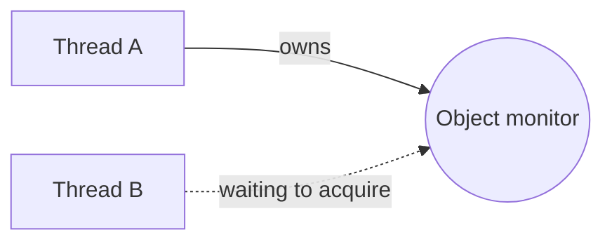

## JMM and Concurrency Fundamentals

Java concurrency is about three separate concerns: atomicity, visibility, and ordering.

### Java Memory Model (JMM)

??? question "Model answer"
    The Java Memory Model defines how threads interact through shared memory, including visibility and ordering guarantees.

    The three main concurrency concerns are atomicity, visibility, and ordering.

    Each Java thread has its own stack, while objects on the heap may be shared between threads. When multiple threads access shared mutable state without proper synchronization, race conditions can occur.

    Volatile provides visibility and ordering guarantees. It is suitable for flags and safe publication, but it does not make compound operations like count++ atomic.

    Synchronized provides mutual exclusion and memory visibility through monitor locks. An unlock happens-before a subsequent lock on the same monitor.

    Atomic classes such as AtomicInteger use atomic operations, often implemented using CAS, and are useful for counters and simple shared state.

    The happens-before relationship is fundamental because it defines when writes from one thread are guaranteed to be visible to another.

    In production, I choose volatile for simple flags, atomic variables for independent atomic updates, and synchronized or explicit locks when multiple operations or fields must remain consistent. For distributed systems, I rely on database transactions or distributed coordination rather than JVM-local synchronization.

The Java Memory Model (JMM), defined in the Java Language Specification, describes how threads interact through shared memory.

It defines which values a thread is allowed to observe and the ordering guarantees provided by synchronization operations.

Without proper synchronization, two threads may observe shared state inconsistently, even when the source code appears straightforward.

- **Atomicity**: An operation behaves as an indivisible action. Other threads cannot observe it partially.
- **Visibility**: A write performed by one thread becomes observable to another thread under the required memory-ordering guarantees.
- **Ordering**: Operations must respect the ordering constraints established by the JMM, even though the compiler and CPU may reorder instructions when doing so preserves permitted behavior.

### Heap vs Stack

The JVM uses different runtime memory areas.

For concurrency, the most important distinction is between thread-specific execution state and objects that may be shared between threads.


#### Stack

Each Java thread has its own JVM stack, containing method frames, local variables, and operand stacks.

#### Heap

Objects and arrays are conceptually allocated on the heap, which is shared across threads. JVM optimizations may eliminate or scalar-replace allocations without changing observable semantics.

```java
class Counter {
    int count = 0;
}

Counter counter = new Counter();

Runnable task = () -> {
    int local = 0;

    local++;
    counter.count++;
};
```

`local` belongs to each invocation of the lambda and is not shared between invocations.

`counter.count` belongs to the shared Counter object, so concurrent updates can race.

**Interview trap**: A local reference variable is thread-confined, but the object it references may still be shared.

### What is thread visibility?

Visibility concerns whether one thread observes another thread's writes.

Consider:

```java
class Worker {
    private boolean running = true;

    void work() {
        while (running) {
            // Perform work
        }
    }

    void stop() {
        running = false;
    }
}
```

Thread A executes `work()`.

Thread B executes `stop()`.

Without a happens-before relationship, Thread A is not guaranteed to observe the updated `running` value promptly — or at all.

This is not necessarily because the value is physically stuck in a CPU cache. Compiler optimizations, CPU reordering, and the JMM's permitted observations all matter.

**Fix using `volatile`**

```java
private volatile boolean running = true;
```

Now a volatile write and subsequent volatile read establish the required visibility and ordering guarantees.

### What is volatile?

`volatile` is a Java field modifier that provides memory visibility and ordering guarantees for accesses to that field.

**Example: shutdown flag**

```java
class Worker {

    private volatile boolean running = true;

    void work() {
        while (running) {
            doWork();
        }
    }

    void stop() {
        running = false;
    }

    private void doWork() {
        // Perform one unit of work
    }
}
```

When Thread B writes `running = false`, Thread A's subsequent volatile reads can observe the update according to the JMM's synchronization rules.

**What volatile guarantees**

- Reads and writes of the volatile variable have visibility guarantees.
- A volatile write happens-before subsequent reads of that same field in synchronization order.
- Volatile accesses impose ordering constraints on surrounding memory operations.
- Volatile reads and writes of the field itself are atomic, including for `long` and `double`.

**What volatile does not guarantee**

It does not make compound operations atomic:

```java
private volatile int count = 0;

void increment() {
    count++; // Still not atomic
}
```

Two threads can still lose updates.

**Senior interview takeaway**: Use `volatile` for independently published state or flags, not as a replacement for atomic read-modify-write operations.

### What is synchronized?

`synchronized` provides mutual exclusion and memory visibility guarantees.

Only one thread can own a particular object's monitor at a time.

**Example**

```java
class Counter {

    private int count = 0;

    public synchronized void increment() {
        count++;
    }

    public synchronized int getCount() {
        return count;
    }
}
```

Both methods synchronize on the same `Counter` instance.

This ensures that increments are mutually exclusive and that readers using the same monitor observe correctly synchronized updates.

#### How synchronized works



After Thread A releases the monitor, another waiting thread may acquire it. No FIFO acquisition order is guaranteed.

#### Synchronized method vs synchronized block

```java
public synchronized void increment() {
    count++;
}
```

is equivalent, for an instance method, to:

```java
public void increment() {
    synchronized (this) {
        count++;
    }
}
```

A synchronized block lets you select a different lock object or reduce the scope of the critical section.

**Important distinction**

A static `synchronized` method locks the `Class` object, while an instance `synchronized` method locks the particular instance.

They do not necessarily block one another.

### What is happens-before?

The happens-before relationship is one of the most important concepts in the Java Memory Model.

If action A happens-before action B, then the effects of A are visible to B, and A is ordered before B under the JMM.

It is a formal ordering relationship, not simply a statement about which operation happened earlier in wall-clock time.

**Important happens-before rules**

| Rule | Guarantee |
| --- | --- |
| Program order | Earlier actions in one thread happen-before later actions in that thread |
| Monitor lock | Unlock happens-before a subsequent lock on the same monitor |
| Volatile | Write happens-before subsequent reads of the same volatile field |
| Thread start | Actions before `start()` happen-before actions in the started thread |
| Thread join | All actions in a thread happen-before another thread successfully returns from `join()` |
| Transitivity | If A happens-before B and B happens-before C, then A happens-before C |

**Example: safe publication with `volatile`**

```java
class Configuration {

    private int timeout;
    private volatile boolean initialized;

    void initialize() {
        timeout = 5000;
        initialized = true;
    }

    void use() {
        if (initialized) {
            System.out.println(timeout);
        }
    }
}
```

Assume one thread initializes the configuration and another calls `use()`.

When the second thread reads `initialized == true`, it is guaranteed to observe the preceding write to `timeout` from the initialization thread.

This is because the write to the volatile flag establishes the necessary happens-before relationship.

The ordering is important:

```java
timeout = 5000;
initialized = true;
```

Publishing the flag before initializing the data would not provide the same guarantee for the later write.

### Memory barriers and instruction reordering

Modern CPUs and compilers may reorder instructions to improve performance, provided the observable behavior respects the Java Memory Model.

Memory barriers, also called fences, are one mechanism used to enforce ordering and visibility constraints.

**Conceptual example**

Without synchronization:

```java
int data = 0;
boolean ready = false;

// Thread A
data = 42;
ready = true;

// Thread B
if (ready) {
    System.out.println(data);
}
```

Thread B is not guaranteed to see `42` when it observes `ready == true`, because there is a data race and no happens-before relationship.

**Correct version**

```java
int data = 0;
volatile boolean ready = false;
```

With the same write order, a thread that reads `ready == true` is guaranteed to observe the preceding write to `data`.

**What barriers do conceptually**

- A release operation prevents earlier relevant memory effects from being reordered after publication.
- An acquire operation prevents later relevant memory operations from being reordered before acquisition.
- Volatile and monitor operations establish ordering constraints that JVM implementations enforce using appropriate compiler and hardware mechanisms.

You generally do not need to manually manage CPU fences in ordinary Java application code.

### Atomic variables

Java provides atomic classes in `java.util.concurrent.atomic`.

Common examples include:

- `AtomicInteger`
- `AtomicLong`
- `AtomicBoolean`
- `AtomicReference`
- `LongAdder`

**`AtomicInteger` example**

```java
import java.util.concurrent.atomic.AtomicInteger;

class Counter {

    private final AtomicInteger count =
        new AtomicInteger();

    public int increment() {
        return count.incrementAndGet();
    }

    public int getCount() {
        return count.get();
    }
}
```

`incrementAndGet()` performs an atomic read-modify-write operation.

**Compare-and-set**

```java
AtomicInteger value = new AtomicInteger(10);

boolean updated = value.compareAndSet(10, 20);

System.out.println(updated);   // true
System.out.println(value.get()); // 20
```

CAS updates the value only if it still matches the expected value.

**`AtomicReference` example**

```java
record State(int version, String status) {}

AtomicReference<State> state =
    new AtomicReference<>(new State(1, "NEW"));

state.updateAndGet(current ->
    new State(current.version() + 1, "ACTIVE")
);
```

The entire `State` reference is atomically replaced.

Because `State` is immutable, readers can safely observe a consistent state object.

### volatile vs synchronized vs AtomicInteger

| Feature | `volatile` | `synchronized` | `AtomicInteger` |
| --- | --- | --- | --- |
| Visibility | Yes | Yes | Yes |
| Atomic read/write | Yes | Yes | Yes |
| Atomic increment | No | Yes | Yes |
| Mutual exclusion | No | Yes | No |
| Multiple-field invariants | Not by itself | Yes, with consistent locking | Not by itself |
| Typical use | Flags, publication | Critical sections | Counters, CAS state |

### Advanced example: correct bank transfer

Suppose we have two account balances stored in memory.

A transfer must subtract money from one account and add it to another as one consistent operation.

```java
class Account {

    private int balance;

    Account(int balance) {
        this.balance = balance;
    }

    int getBalance() {
        return balance;
    }

    void setBalance(int balance) {
        this.balance = balance;
    }
}
```

Using `volatile` fields would not make the transfer atomic.

A simple solution is to protect both balances with a common lock.

```java
class Bank {

    private final Object lock = new Object();

    public void transfer(
            Account from,
            Account to,
            int amount) {

        if (amount <= 0) {
            throw new IllegalArgumentException(
                "Amount must be positive"
            );
        }

        synchronized (lock) {
            if (from.getBalance() < amount) {
                throw new IllegalStateException(
                    "Insufficient balance"
                );
            }

            from.setBalance(
                from.getBalance() - amount
            );

            to.setBalance(
                to.getBalance() + amount
            );
        }
    }
}
```

This is safe only if all access to the account balances follows the same synchronization protocol. A real system should encapsulate balance access and avoid exposing unsynchronized setters or readers.

For a production banking application, database transactions are generally required because in-memory locks do not coordinate across multiple application instances or survive crashes.

### Senior Java interview traps

- **Trap A — `volatile` makes `count++` thread-safe:** False. Visibility does not imply atomicity for compound operations.
- **Trap B — `synchronized` always locks the entire class:** False. Instance `synchronized` methods lock the instance. Static `synchronized` methods lock the `Class` object.
- **Trap C — `AtomicInteger` guarantees all business operations are atomic:** False. It only guarantees atomicity for its own documented operations.
- **Trap D — Thread-safe collections automatically protect multi-step workflows:** False. Compound operations may require atomic methods or additional synchronization.
- **Trap E — Happens-before means one operation happened earlier in real time:** Not necessarily. Happens-before is a formal memory-ordering relationship.
- **Trap F — `volatile` always makes code faster than `synchronized`:** False. Performance depends on contention, workload, JVM optimizations, and the required correctness guarantees.
