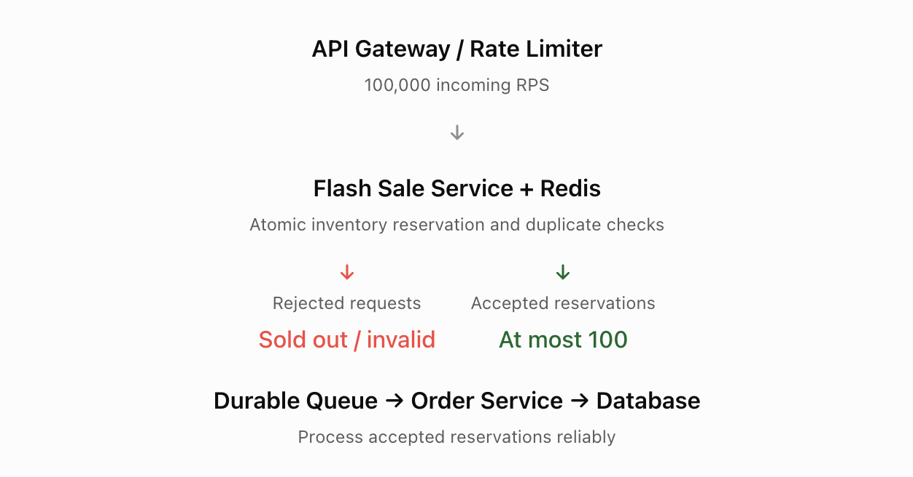
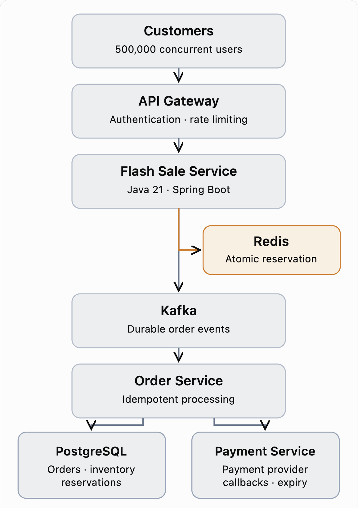
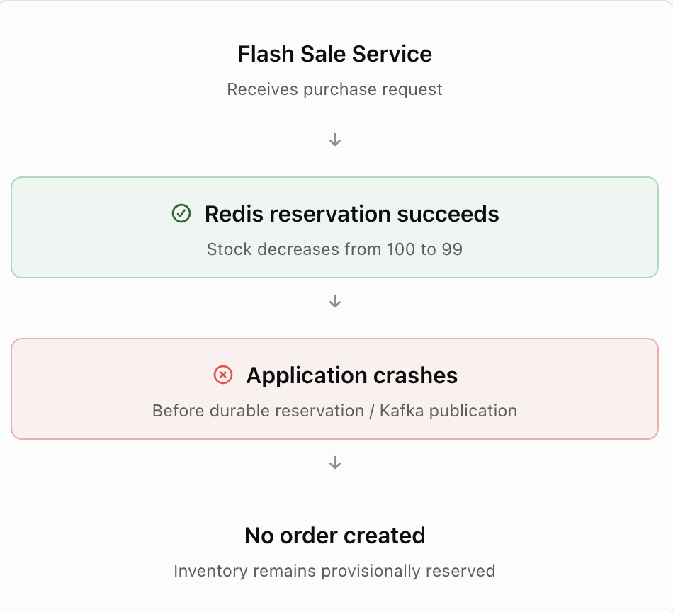
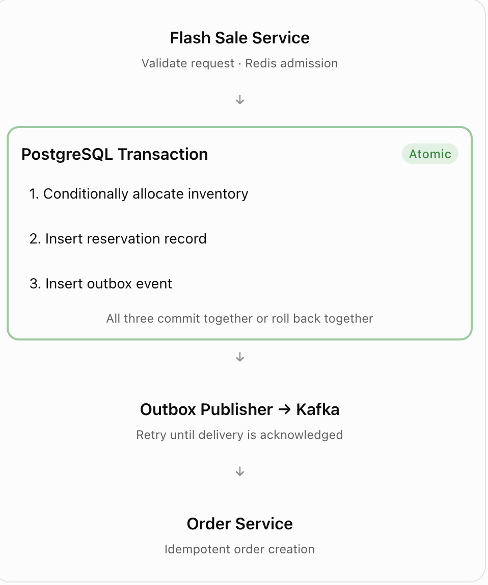
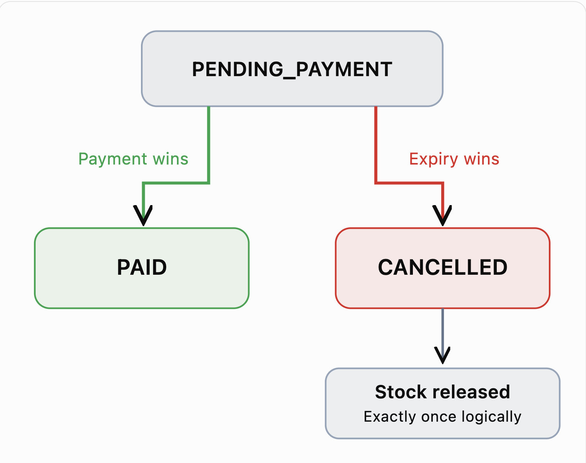

# Flash Sale System Design

## Problem statement

Your company operates a large e-commerce platform similar to Shopee or Lazada.

The company wants to launch a flash sale campaign where customers can purchase products at
significantly discounted prices for a limited period.

### Initial business information

| Metric                       | Value                |
| ---------------------------- | -------------------- |
| Registered users             | 10 million           |
| Concurrent users during sale | 500,000              |
| Flash sale duration          | 10 minutes           |
| Products in campaign         | 1,000                |
| Stock of a popular product   | 100 units            |
| Backend stack                | Java 21, Spring Boot |
| Infrastructure               | AWS                  |

The business has emphasized two critical requirements:

- **No overselling**: If a product has 100 units, the system must not sell more than 100.
- **High availability**: The platform should remain responsive even when hundreds of thousands of
  users attempt to purchase simultaneously.

## Clarifying questions

### Functional requirements

| Question to ask                                         | Why it matters                                 |
| ------------------------------------------------------- | ---------------------------------------------- |
| Can users purchase multiple units of the same products? | Determines purchase limits and inventory rules |
| Can a user purchase the same product multiple times?    | Prevents abuse and duplicate purchases         |
| Do users need to complete payment immediately?          | Affects stock reservation and payment design   |
| What happens if payment fails or timeout?               | Determines inventory release logic             |
| Can users cancel an order?                              | Determines inventory recovery                  |
| Should users receive immediate order confirmation?      | Affects synchronous vs asynchronous processing |
| What happens when a product sells out?                  | Determines API responses and user experience   |

**Important**: For flash sales, distinguish between *reserving* stock and *selling* stock.

### Non-functional requirements

| Question                                                   | Why it matters                                |
| ---------------------------------------------------------- | --------------------------------------------- |
| What is the expected peak request rate?                    | Determines required capacity                  |
| What is the acceptable response latency?                   | Influences architecture and caching           |
| What availability target is required?                      | Determines redundancy and recovery strategy   |
| Is inventory consistency more important than availability? | Determines how stock operations are handled   |
| Can order processing be asynchronous?                      | Determines whether queues are suitable        |
| How should the system handle traffic beyond its capacity?  | Determines throttling and overload protection |
| What happens if Redis, Kafka, or the database fails?       | Determines fault tolerance                    |

### Business constraints — what are the priorities?

Ask about fairness, fraud prevention, existing systems, and budget. For example:

- Should purchases be first-come, first-served, or should the platform use a queue?
- Must we integrate with existing inventory, payment, and order services?
- Can the system reject requests quickly during extreme traffic?
- Is the business willing to accept delayed order confirmation?

### Conclusion after clarification

| Metric                    | Value       |
| ------------------------- | ----------- |
| Concurrent users          | 500,000     |
| Peak purchase requests    | 100,000 RPS |
| Flash sale duration       | 600 seconds |
| Popular product inventory | 100 units   |

## Capacity estimation

### Request rate

500,000 concurrent users does not mean 500,000 requests per second. We have to calculate the
actual requests per second. For example, if 500,000 users submit one purchase request within
5 seconds:

```text
RPS = 500,000 / 5 = 100,000 req/s
```

Maximum purchase requests during the entire event if peak traffic were sustained:

```text
100,000 * 600 = 60,000,000 requests
```

### Application concurrency

We have a target P95 latency below 200 ms for the initial request acknowledgement.

```text
Concurrency = Throughput x Latency
            = 100,000 x 0.2
            = 20,000 requests in flight
```

That means approximately 20,000 requests could be in flight across the application tier. This
matters for HTTP connection handling, thread pools, CPU utilization, memory, and downstream
connection pools.

### Database workload

We have to use a conditional atomic update that prevents negative stock, but sending 100,000
competing updates per second to the same row would create severe database contention.

The capacity problem is therefore not only the number of database connections — it is also
**hot-row contention**.

### Reducing database workload

A possible architecture uses a fast admission and inventory reservation layer to prevent every
incoming request from reaching the database.



For a product with only 100 units, the goal is to avoid creating 100,000 database transactions
when only 100 reservations can succeed.

Redis can use an atomic Lua script to check inventory and enforce purchase limits. However, Redis
alone is not sufficient to guarantee correctness. We must also consider durability, failover,
reservation recovery, idempotency, and database reconciliation.

### Application instances

Suppose a load test demonstrates that one Spring Boot instance can sustain 2,000 RPS while meeting
the latency target:

```text
Instances = 100,000 / 2,000 = 50
```

If we target 70% maximum utilization to retain headroom:

```text
Instances = 100,000 / (2,000 * 0.7) ≈ 72
```

We should also consider load balancer capacity, Redis throughput, queue partitions, and database
connection limits.

### Common estimation mistakes

| Common mistake                                             | Better approach                                                   |
| ---------------------------------------------------------- | ----------------------------------------------------------------- |
| 500,000 users = 500,000 RPS                                | Estimate request frequency and burst patterns                     |
| Every purchase request must update the database            | Reject invalid or sold-out requests early                         |
| Redis guarantees no overselling in all failure scenarios   | Explain atomicity, durability, and recovery                       |
| Kafka automatically guarantees order creation              | Design reliable message publication, consumption, and idempotency |
| More application instances solve every bottleneck          | Identify shared bottlenecks such as hot keys and database rows    |
| Assume 2,000 RPS per instance is guaranteed                | Verify throughput with representative load testing                |

## High-level architecture



| Component          | Responsibility                                                         |
| ------------------ | ---------------------------------------------------------------------- |
| API Gateway        | Authentication, rate limiting, request routing                         |
| Flash Sale Service | Validate eligibility, enforce purchase limits, coordinate reservations |
| Redis              | Fast atomic inventory admission and duplicate checks                   |
| Kafka              | Decouple accepted purchases from order processing                      |
| Order Service      | Persist orders and reservations idempotently                           |
| PostgreSQL         | Authoritative inventory, orders, and reservation records               |
| Payment Service    | Process payment, callbacks, timeouts, and refunds                      |

### Purchase flow

#### Step 1 — Customer clicks "Buy now"

The client sends `POST /flash-sales/{saleId}/purchase` with an idempotency key.

The gateway authenticates the user and applies rate limits to protect the system.

#### Step 2 — Reserve inventory atomically

The Flash Sale Service uses a Redis Lua script to atomically verify available stock and enforce
the per-user purchase limit.

If successful, Redis records a provisional reservation and decrements available stock. Otherwise,
the request is rejected.

#### Step 3 — Make the reservation durable

The system must durably record the accepted reservation and arrange reliable publication of an
order event.

A transactional outbox with a database-backed reservation is one robust option. A Redis-first
design needs an explicit durable handoff and recovery protocol before telling the customer their
reservation is confirmed.

We must not assume that a successful Redis decrement followed by a Kafka send is an atomic
transaction.

#### Step 4 — Create the order

The Order Service consumes the event and creates an order with status `PENDING_PAYMENT`.

A unique reservation or order identifier prevents duplicate order creation when Kafka redelivers
an event.

#### Step 5 — Process payment

The customer receives payment instructions. The system tracks the five-minute payment deadline.

On successful payment, the order transitions to `PAID`. On expiry or confirmed payment failure,
the reservation is released safely.

### The most important design decision: no overselling

Redis can efficiently control access to limited stock, but correctness must survive retries,
crashes, and failovers.

For example, consider a Lua script that atomically:

1. Checks whether a user already has a reservation.
2. Checks whether available inventory is greater than zero.
3. Decrements inventory.
4. Records the reservation.

This prevents concurrent requests on the same Redis primary from independently decrementing the
same stock. However, asynchronous Redis replication may lose an acknowledged write during failover.

For a strict no-overselling requirement, PostgreSQL remains the authoritative inventory system and
the durable reservation protocol must ensure the total number of active and completed allocations
never exceeds the initial stock.

A safe database guard:

```sql
UPDATE inventory
SET available = available - 1,
    reserved = reserved + 1
WHERE product_id = :productId
  AND available > 0;
```

### Design decision trade-offs

| Decision                    | Advantage                    | Trade-off                                   |
| --------------------------- | ---------------------------- | ------------------------------------------- |
| Redis admission             | Low-latency rejection        | Cache consistency and failover complexity   |
| Kafka                       | Decouples order processing   | Eventual consistency and duplicate delivery |
| PostgreSQL transactions     | Strong inventory correctness | Hot-row contention                          |
| Transactional Outbox        | Reliable event publication   | Additional storage and publisher operations |
| Asynchronous order creation | Protects downstream services | Delayed order confirmation                  |
| Idempotency keys            | Safe request retries         | Requires durable deduplication              |

## Failure scenario: Redis crash before durable reservation

**Problem**: the Flash Sale Service crashes before the reservation is durably recorded or
published to Kafka.

**Think about**: idempotency, reservation state, atomicity across Redis and Kafka, and recovery
mechanisms.

The key problem is that **Redis and Kafka cannot participate in a single ordinary ACID
transaction**.



Three problems can happen:

- **Inventory leakage**: Stock is reserved but never released.
- **Duplicate processing**: The user retries and the system processes the same purchase again.
- **Inconsistent state**: Redis says stock is reserved, but the database has no corresponding
  reservation.

### Possible solutions

| Solution               | Benefit                                | Limitation                                         |
| ---------------------- | -------------------------------------- | -------------------------------------------------- |
| Redis TTL              | Can identify expired reservations      | TTL alone doesn't guarantee safe stock restoration |
| Redis Lua + Kafka      | Fast inventory operations              | Not atomic across Redis and Kafka                  |
| Kafka producer retries | Improves delivery reliability          | Cannot recover events never durably recorded       |
| Transactional Outbox   | Atomic reservation and event recording | Requires database transaction and outbox publisher |
| Saga / compensation    | Handles multi-step business workflows  | Requires idempotent compensation and recovery      |

**Recommendation**: use a durable reservation with the Transactional Outbox pattern. Keep Redis as
an admission optimization rather than the sole authority for inventory.



```java
@Transactional
public Reservation reserve(
        Long userId,
        Long productId,
        String requestId) {

    // Durable idempotency check
    var existing = reservationRepository
            .findByRequestId(requestId);

    if (existing.isPresent()) {
        return existing.get();
    }

    // Atomic conditional inventory update
    int updated = inventoryRepository
            .reserveStock(productId);

    if (updated == 0) {
        throw new SoldOutException();
    }

    Reservation reservation =
            reservationRepository.save(
                new Reservation(
                    requestId,
                    userId,
                    productId,
                    "RESERVED"
                )
            );

    outboxRepository.save(
        OutboxEvent.orderRequested(
            reservation.getId()
        )
    );

    return reservation;
}
```

### What happens when the customer retries?

The client should send the same idempotency key when retrying the same logical purchase.

```http
POST /flash-sales/123/purchase
Idempotency-Key: purchase-user456-sale123
```

We have three cases:

- **Before database commit**: The transaction rolls back; no durable reservation or outbox event
  exists. The retry can attempt a new reservation. Any provisional Redis admission must be
  reconciled or released safely.
- **After database commit**: The durable reservation and outbox event already exist. A retry with
  the same idempotency key returns the same logical result without consuming another unit.
- **After Kafka publication**: A duplicate event is safe — the outbox publisher may publish the
  event again. The Order Service uses a unique reservation ID to ensure only one order is created.

### What about the original Redis reservation?

The Transactional Outbox solves the database-to-Kafka consistency problem, but **it does not
automatically solve a Redis decrement that occurred before the database transaction.** We must
handle this separately.

### Option 1: TTL lease pattern

Instead of storing raw inventory numbers as simple static keys (`SET stock:item:1001 100`), tie
every reservation to an **ephemeral Redis hash with a TTL** or use Redis hashes to track active
user leases.

When an application instance grabs items for a checkout session:

1. It creates a reservation key in Redis with a strict TTL:

   ```lua
   HSET reservation:uuid-xyz-123 item_id 1001 quantity 100
   EXPIRE reservation:uuid-xyz-123 180
   ```

2. If the application crashes, it never completes the order and never hits the API to clear the
   reservation.
3. Once the 3-minute TTL expires, **Redis automatically deletes the key**.

#### Returning the stock on expiration

Configure **Redis Keyspace Notifications** (`notify-keyspace-events Ex`) to listen for expired
keys. When a reservation key expires, a background subscriber (or a scheduled recovery worker)
catches the expired key event and safely increments the stock back in Redis
(`INCRBY stock:item:1001 100`).

#### Implementation: keyspace notifications

To listen for Redis expired key events in Spring Boot and automatically restore inventory when a
reservation times out, configure three things:

1. Enable **Redis Keyspace Notifications** in your Redis server.
2. Configure Spring Data Redis to listen to the expiration channel using a
   `MessageListenerAdapter`.
3. Implement a listener class that handles the expired key event and triggers an atomic stock
   restoration (`INCRBY`) back into Redis.

##### Step 1: Enable Redis keyspace notifications

Redis does not publish expiration events by default, to save memory and CPU. Enable `Ex` events
(E = events, x = expired) either in `redis.conf` or dynamically via the Redis CLI:

```bash
redis-cli CONFIG SET notify-keyspace-events Ex
```

*(For production, ensure this is set in your persistent `redis.conf` so it survives restarts.)*

##### Step 2: Configure the Redis message listener in Spring Boot

Register a `RedisMessageListenerContainer` and wire it to a custom message listener bean:

```java
import org.springframework.context.annotation.Bean;
import org.springframework.context.annotation.Configuration;
import org.springframework.data.redis.connection.RedisConnectionFactory;
import org.springframework.data.redis.listener.PatternTopic;
import org.springframework.data.redis.listener.RedisMessageListenerContainer;
import org.springframework.data.redis.listener.adapter.MessageListenerAdapter;

@Configuration
public class RedisListenerConfig {

    @Bean
    public MessageListenerAdapter messageListenerAdapter(RedisKeyExpirationListener listener) {
        return new MessageListenerAdapter(listener, "onMessage");
    }

    @Bean
    public RedisMessageListenerContainer redisContainer(RedisConnectionFactory connectionFactory, MessageListenerAdapter listenerAdapter) {
        RedisMessageListenerContainer container = new RedisMessageListenerContainer();
        container.setConnectionFactory(connectionFactory);

        // Listen to expiration events from all databases (__keyevent@*__:expired)
        // or target a specific database (e.g., __keyevent@0__:expired)
        container.addMessageListener(listenerAdapter, new PatternTopic("__keyevent@*__:expired"));

        return container;
    }
}
```

##### Step 3: Implement the expiration event listener

When a reservation key (e.g., `reservation:12345`) expires, Redis triggers the event. The listener
extracts the item ID from the expired key and safely restores the inventory using an atomic
`INCRBY` or Lua script:

```java
import org.springframework.data.redis.connection.Message;
import org.springframework.data.redis.connection.MessageListener;
import org.springframework.data.redis.core.StringRedisTemplate;
import org.springframework.stereotype.Component;

@Component
public class RedisKeyExpirationListener implements MessageListener {

    private final StringRedisTemplate redisTemplate;

    public RedisKeyExpirationListener(StringRedisTemplate redisTemplate) {
        this.redisTemplate = redisTemplate;
    }

    @Override
    public void onMessage(Message message, byte[] pattern) {
        String expiredKey = message.toString();

        // Check if the expired key matches our reservation pattern (e.g., "reservation:item_1001:uuid")
        if (expiredKey.startsWith("reservation:")) {
            String[] parts = expiredKey.split(":");
            if (parts.length >= 2) {
                String itemId = parts[1]; // Extract the item ID

                // For this example, let's assume each expired reservation returns 1 unit of stock back
                String stockKey = "stock:item:" + itemId;

                // Atomically increment the stock back in Redis
                Long newStock = redisTemplate.opsForValue().increment(stockKey, 1);

                System.out.println("Reservation timed out for key: " + expiredKey +
                                   ". Restored 1 item to stock. New stock count: " + newStock);

                // Optional: Update your PostgreSQL database asynchronously to mark the order as EXPIRED
            }
        }
    }
}
```

##### Step 4: Create the reservation with a TTL

When a user initiates a checkout, create the reservation key with a strict expiration time (e.g.,
180 seconds for 3 minutes):

```java
public void createReservation(String userId, String itemId, String reservationUuid) {
    String reservationKey = "reservation:" + itemId + ":" + reservationUuid;

    // Save the reservation with a 3-minute TTL
    redisTemplate.opsForValue().set(reservationKey, userId, Duration.ofSeconds(180));
}
```

**Important distributed caveat**: Redis keyspace notifications are **fire-and-forget** and not
guaranteed to be delivered reliably across partitioned clusters or if a listener instance goes
down right when the event fires. For ultra-critical flash sale systems, use this pattern as a fast
UI cleanup mechanism, and pair it with a **PostgreSQL reconciliation worker** as an authoritative
safety net to catch any missed expirations.

### Option 2: Distributed lock with heartbeat (lease renewal)

If the 100 items are allocated to a specific application node or worker thread rather than an
individual buyer:

- The node must acquire a **distributed lock** (using Redisson or standard Redis lock patterns)
  with a short lease time (e.g., 30 seconds).
- While the node is healthy and processing orders, a background thread renews the lease
  (heartbeat) every 10 seconds.
- If the application crashes, it stops sending heartbeats. The lease expires, and Redis
  automatically releases the lock and returns the 100 items to the active pool.

#### Implementation: With Redisson

Redisson handles the heartbeat, unique ownership tokens, thread scheduling, and TTL extensions
completely under the hood with zero manual boilerplate:

```java
import org.redisson.api.RLock;
import org.redisson.api.RedissonClient;
import org.springframework.stereotype.Component;

@Component
public class RedissonLockedJob {

    private final RedissonClient redissonClient;

    public RedissonLockedJob(RedissonClient redissonClient) {
        this.redissonClient = redissonClient;
    }

    public void executeJob() {
        RLock lock = redissonClient.getLock("lock:order-reconciliation");

        // 1. Acquire lock. No lease time specified -> enables the automated Watchdog!
        // The watchdog starts a background thread renewing the TTL every 10 seconds.
        lock.lock(); 

        try {
            System.out.println("Lock acquired via Redisson. Running job...");
            // Your long-running business logic here...
            Thread.sleep(15000); 
        } catch (InterruptedException e) {
            Thread.currentThread().interrupt();
        } finally {
            // 2. Safely release lock and kill the watchdog for this thread
            if (lock.isHeldByCurrentThread()) {
                lock.unlock();
            }
        }
    }
}
```

#### Implementation: Without Redisson

Without Redisson, you must manually generate a unique owner token, use a scheduled executor
service to run a background heartbeat task, write custom Lua scripts for atomic TTL renewals, and
handle thread cleanup yourself:

```java
import org.springframework.data.redis.core.StringRedisTemplate;
import org.springframework.data.redis.core.script.DefaultRedisScript;
import org.springframework.stereotype.Component;

import java.time.Duration;
import java.util.Collections;
import java.util.UUID;
import java.util.concurrent.*;

@Component
public class ManualHeartbeatLockedJob {

    private final StringRedisTemplate redisTemplate;

    private static final String RENEW_SCRIPT = 
        "if redis.call('get', KEYS[1]) == ARGV[1] then " +
        "    return redis.call('pexpire', KEYS[1], ARGV[2]) " +
        "else " +
        "    return 0 " +
        "end";

    private static final String RELEASE_SCRIPT = 
        "if redis.call('get', KEYS[1]) == ARGV[1] then " +
        "    return redis.call('del', KEYS[1]) " +
        "else " +
        "    return 0 " +
        "end";

    public ManualHeartbeatLockedJob(StringRedisTemplate redisTemplate) {
        this.redisTemplate = redisTemplate;
    }

    public void executeJob() {
        String lockKey = "lock:order-reconciliation";
        String ownerToken = UUID.randomUUID().toString();
        long lockTtlMillis = 30000; // 30 seconds

        // 1. Try to acquire the lock initially
        Boolean acquired = redisTemplate.opsForValue()
                .setIfAbsent(lockKey, ownerToken, Duration.ofMillis(lockTtlMillis));

        if (Boolean.FALSE.equals(acquired)) {
            System.out.println("Could not acquire lock. Another instance is running.");
            return;
        }

        // 2. Schedule manual background heartbeat thread
        ScheduledExecutorService scheduler = Executors.newSingleThreadScheduledExecutor();
        long renewalInterval = lockTtlMillis / 3; // Renew every 10 seconds

        ScheduledFuture<?> heartbeatTask = scheduler.scheduleAtFixedRate(() -> {
            try {
                DefaultRedisScript<Long> script = new DefaultRedisScript<>(RENEW_SCRIPT, Long.class);
                redisTemplate.execute(script, Collections.singletonList(lockKey), ownerToken, String.valueOf(lockTtlMillis));
            } catch (Exception e) {
                System.err.println("Heartbeat renewal failed: " + e.getMessage());
            }
        }, renewalInterval, renewalInterval, TimeUnit.MILLISECONDS);

        try {
            System.out.println("Lock acquired manually. Running job...");
            // Your long-running business logic here...
            Thread.sleep(15000);
        } catch (InterruptedException e) {
            Thread.currentThread().interrupt();
        } finally {
            // 3. Cancel heartbeat thread and safely release lock using Lua script
            heartbeatTask.cancel(true);
            scheduler.shutdown();

            DefaultRedisScript<Long> releaseScript = new DefaultRedisScript<>(RELEASE_SCRIPT, Long.class);
            redisTemplate.execute(releaseScript, Collections.singletonList(lockKey), ownerToken);
        }
    }
}
```

#### Trade-offs: Redisson vs manual heartbeat

| Feature      | With Redisson                                                        | Without Redisson (manual)                                                    |
| ------------ | -------------------------------------------------------------------- | ---------------------------------------------------------------------------- |
| Boilerplate  | Minimal (1 line `lock.lock()`)                                       | High (requires scheduling, UUIDs, and custom Lua scripts)                    |
| Error safety | Robust (cleans up on thread interruption or JVM crashes)             | Prone to resource leaks if executors aren't shut down in `finally` blocks    |
| Dependencies | Requires the `redisson-spring-boot-starter` library                  | Works with standard Spring Data Redis (`StringRedisTemplate`)                |

### Option 3: Asynchronous database reconciliation worker

Redis is fast, but it is volatile. For absolute safety during flash sales, pair Redis with a
scheduled reconciliation cron job running in Java (or a database-level event listener):

1. **Track state in PostgreSQL**: every time Redis reserves stock, create a corresponding record
   in PostgreSQL with a status of `PENDING` and a created timestamp.

2. **Reconciliation cron job**: run a lightweight background worker every minute:

   ```sql
   -- Find orders stuck in PENDING for more than 5 minutes
   SELECT * FROM orders
   WHERE status = 'PENDING' AND created_at < NOW() - INTERVAL '5 minutes';
   ```

3. **Rollback and restore**: for every abandoned order found, the worker executes a safe cleanup
   transaction:

   - Marks the PostgreSQL order as `EXPIRED`.
   - Sends an atomic `INCRBY` command back to Redis to return the stock to the available pool.

#### Implementation: database reconciliation

To act as an authoritative safety net for missed Redis expiration events or multi-instance server
crashes, implement a scheduled background job in Spring Boot using PostgreSQL's
**`SELECT ... FOR UPDATE SKIP LOCKED`** pattern.

This pattern allows multiple application instances to run the cron job concurrently without
stepping on each other or double-restoring inventory.

##### Step 1: PostgreSQL order repository query

Create a repository method that fetches abandoned `PENDING` orders older than your threshold
(e.g., 3 minutes) while safely locking those rows so other server instances ignore them:

```java
import org.springframework.data.jpa.repository.JpaRepository;
import org.springframework.data.jpa.repository.Lock;
import org.springframework.data.jpa.repository.Query;
import org.springframework.data.repository.query.Param;
import jakarta.persistence.LockModeType;
import java.time.LocalDateTime;
import java.util.List;

public interface OrderRepository extends JpaRepository<Order, Long> {

    @Lock(LockModeType.PESSIMISTIC_WRITE)
    @Query("SELECT o FROM Order o WHERE o.status = 'PENDING' AND o.createdAt < :threshold")
    List<Order> findExpiredPendingOrdersForUpdate(@Param("threshold") LocalDateTime threshold);
}
```

##### Step 2: The scheduled reconciliation worker

Create a scheduled component that runs periodically (e.g., every 60 seconds), finds abandoned
orders, marks them as expired in PostgreSQL, and atomically restores the stock back into Redis:

```java
import org.springframework.data.redis.core.StringRedisTemplate;
import org.springframework.scheduling.annotation.Scheduled;
import org.springframework.stereotype.Component;
import org.springframework.transaction.annotation.Transactional;
import java.time.LocalDateTime;
import java.util.List;

@Component
public class OrderReconciliationWorker {

    private final OrderRepository orderRepository;
    private final StringRedisTemplate redisTemplate;

    public OrderReconciliationWorker(OrderRepository orderRepository, StringRedisTemplate redisTemplate) {
        this.orderRepository = orderRepository;
        this.redisTemplate = redisTemplate;
    }

    // Run every 60 seconds
    @Scheduled(fixedRate = 60000)
    @Transactional
    public void reconcileAbandonedOrders() {
        // Define the threshold (e.g., orders older than 3 minutes still stuck in PENDING)
        LocalDateTime threshold = LocalDateTime.now().minusMinutes(3);

        // Fetch expired orders with a pessimistic row lock
        List<Order> expiredOrders = orderRepository.findExpiredPendingOrdersForUpdate(threshold);

        if (expiredOrders.isEmpty()) {
            return;
        }

        System.out.println("Found " + expiredOrders.size() + " abandoned orders to reconcile.");

        for (Order order : expiredOrders) {
            try {
                // 1. Update status in PostgreSQL to EXPIRED
                order.setStatus("EXPIRED");
                orderRepository.save(order);

                // 2. Atomically restore the stock back into Redis
                String stockKey = "stock:item:" + order.getItemId();
                Long restoredStock = redisTemplate.opsForValue().increment(stockKey, order.getQuantity());

                System.out.println("Reconciled Order ID: " + order.getId() +
                                   " | Restored " + order.getQuantity() +
                                   " items to stock. New Redis stock: " + restoredStock);

            } catch (Exception e) {
                System.err.println("Failed to reconcile order ID " + order.getId() + ": " + e.getMessage());
                // Throwing an exception here will rollback the transaction for this specific batch
                // allowing it to be retried on the next cron cycle.
                throw e;
            }
        }
    }
}
```

##### Why this architecture works robustly

- **`PESSIMISTIC_WRITE` & `SKIP LOCKED`**: if you scale the application to 5 instances, all 5 might
  trigger the cron job at the same time. PostgreSQL ensures whichever instance grabs the rows
  first locks them, while other instances skip those rows (`SKIP LOCKED`), eliminating duplicate
  processing and race conditions.
- **Transactional safety**: database state changes (`status = 'EXPIRED'`) and Redis updates are
  bound together logically. If Redis fails, the transaction rolls back, and consistency is
  retried on the next run.
- **Decoupled fallback**: even if Redis completely drops a keyspace expiration event or a network
  partition occurs, this worker cleans up the mess within minutes, guaranteeing that locked
  flash-sale inventory eventually returns to the active pool.

#### Alternative: leader election via distributed lock

Instead of letting every instance query PostgreSQL and rely on `SKIP LOCKED`, you can use
**Redisson** to elect a single leader per cron cycle. Only the instance that acquires the
distributed lock runs the reconciliation; the others skip immediately.

This prevents database row-locking contention entirely — only one instance ever touches the
database.

##### Step 1: Add the Redisson dependency and configuration

Add the Redisson Spring Boot starter to your `pom.xml`:

```xml
<dependency>
    <groupId>org.redisson</groupId>
    <artifactId>redisson-spring-boot-starter</artifactId>
    <version>3.27.2</version>
</dependency>
```

Configure your Redis connection in `application.yml`:

```yaml
spring:
  data:
    redis:
      host: localhost
      port: 6379
```

##### Step 2: Implement the distributed lock in the scheduled job

Inject `RedissonClient` into the reconciliation worker, wrap the logic in an `RLock` block, and
use `tryLock` with a lease time so that if the instance holding the lock crashes, Redis
automatically releases it.

Note that the transactional work lives on a **separate bean**: `@Transactional` only applies
through Spring's proxy, so a self-invoked or `protected` method on the same class would run
without a transaction.

```java
import org.redisson.api.RLock;
import org.redisson.api.RedissonClient;
import org.springframework.scheduling.annotation.Scheduled;
import org.springframework.stereotype.Component;

import java.util.concurrent.TimeUnit;

@Component
public class OrderReconciliationWorker {

    private final RedissonClient redissonClient;
    private final ReconciliationService reconciliationService;

    public OrderReconciliationWorker(RedissonClient redissonClient,
                                     ReconciliationService reconciliationService) {
        this.redissonClient = redissonClient;
        this.reconciliationService = reconciliationService;
    }

    // Run every 60 seconds
    @Scheduled(fixedRate = 60000)
    public void reconcileAbandonedOrders() {
        RLock lock = redissonClient.getLock("lock:order-reconciliation");

        try {
            // Try to acquire the lock:
            // - waitTime = 0 (don't wait; if another instance has it, skip immediately)
            // - leaseTime = 30 seconds (automatically release lock if the pod crashes mid-execution)
            boolean isLocked = lock.tryLock(0, 30, TimeUnit.SECONDS);

            if (!isLocked) {
                // Another instance is already running the job; skip this cycle quietly.
                return;
            }

            System.out.println("Lock acquired successfully. Running reconciliation job...");
            reconciliationService.expireAbandonedOrders();

        } catch (InterruptedException e) {
            Thread.currentThread().interrupt();
            System.err.println("Reconciliation lock thread interrupted: " + e.getMessage());
        } finally {
            // Always unlock only if the current thread still holds the lock
            if (lock.isHeldByCurrentThread()) {
                lock.unlock();
            }
        }
    }
}
```

```java
import org.springframework.data.redis.core.StringRedisTemplate;
import org.springframework.stereotype.Service;
import org.springframework.transaction.annotation.Transactional;

import java.time.LocalDateTime;
import java.util.List;

@Service
public class ReconciliationService {

    private final OrderRepository orderRepository;
    private final StringRedisTemplate redisTemplate;

    public ReconciliationService(OrderRepository orderRepository,
                                 StringRedisTemplate redisTemplate) {
        this.orderRepository = orderRepository;
        this.redisTemplate = redisTemplate;
    }

    @Transactional
    public void expireAbandonedOrders() {
        LocalDateTime threshold = LocalDateTime.now().minusMinutes(3);
        List<Order> expiredOrders = orderRepository
                .findExpiredPendingOrdersForUpdate(threshold);

        for (Order order : expiredOrders) {
            // 1. Update status in PostgreSQL to EXPIRED
            order.setStatus("EXPIRED");
            orderRepository.save(order);

            // 2. Atomically restore the stock back into Redis
            String stockKey = "stock:item:" + order.getItemId();
            redisTemplate.opsForValue().increment(stockKey, order.getQuantity());
        }
    }
}
```

##### Why this pattern excels in Kubernetes

1. **Zero database overhead**: instead of all 5 replicas querying PostgreSQL simultaneously to
   lock rows, only *one* replica ever grabs the Redis lock and executes the query. The other 4
   exit immediately at `tryLock(0, ...)` without touching the database.
2. **Crash safety via lease time**: if the leader instance crashes (OOM, pod eviction), the
   30-second lease ensures Redis automatically drops the lock, letting another healthy replica
   take over on the next cron cycle.

### Reconciliation rules

1. Every provisional Redis reservation has a unique reservation ID and expiration deadline.
2. The Redis reservation is only a temporary admission claim, not proof that an order exists.
3. A reconciliation worker checks expired provisional claims against the authoritative database.
4. If there is no durable reservation, the claim can be released idempotently.
5. If the database has a valid reservation, Redis must not release its stock allocation
   incorrectly.
6. Redis recovery or failover must never create more confirmed reservations than the authoritative
   database permits.

A Redis Lua script can atomically check and release an individual provisional claim, but its
release logic must be designed to avoid double increments.

For this reason, Redis inventory should be viewed as a bounded admission mechanism, with
PostgreSQL enforcing the final inventory allocation.

### What a senior engineer should recognize

- Atomic Redis operations do not make Redis and Kafka atomic together.
- Kafka's exactly-once features do not automatically make database side effects exactly once.
- Database constraints and transactions are essential for authoritative correctness.
- Idempotency protects against duplicate logical requests and message redelivery.
- Reconciliation is necessary when independent systems can become inconsistent.
- A high-throughput architecture must also address database hot-row contention.

## Failure scenario: payment timeout race condition

**Problem**: a customer successfully reserves the last unit of a product. The order is created
with status `PENDING_PAYMENT`, and the customer has five minutes to pay.

At exactly the five-minute deadline, two events happen concurrently:

- **Thread A**: the payment provider sends a successful payment callback.
- **Thread B**: the expiration worker attempts to cancel the order and release the reserved
  inventory.

Both threads read the order status as `PENDING_PAYMENT`.

**Think about**: optimistic locking, conditional updates, transaction boundaries, idempotency, and
payment reconciliation.

The answer combines **order state machine + conditional database updates + idempotency + payment
reconciliation**.

### Order state machine



The most important rule is:

**Only one transition out of `PENDING_PAYMENT` can succeed.**

If payment wins, expiration must not release inventory. If expiration wins, a late successful
payment must trigger reconciliation or refund rather than marking the cancelled order as paid.

### Conditional database update

The easiest reliable approach for this scenario is a conditional SQL update.

Payment callback:

```sql
UPDATE orders
SET status = 'PAID',
    updated_at = NOW()
WHERE id = :orderId
  AND status = 'PENDING_PAYMENT';
```

Expiration worker:

```sql
UPDATE orders
SET status = 'CANCELLED',
    updated_at = NOW()
WHERE id = :orderId
  AND status = 'PENDING_PAYMENT';
```

## Production incident: traffic spike during the campaign

**Problem**: during the first minute of the campaign:

- Incoming traffic reaches 800,000 RPS.
- API P95 latency increases from 150 ms to 3 seconds.
- PostgreSQL CPU reaches 95%.
- Database connection pool usage reaches 100%.
- Customers start receiving HTTP 500 errors.
- Inventory is still correct, with no overselling.

### What should I do?

- Declare the incident and protect critical operations.
- Reduce incoming workload.
- Check system metrics.
- Apply a safe mitigation.
- Verify recovery.

#### Declare the incident and protect critical operations

- Acknowledge the incident, assign an incident owner, and communicate with the operations team.
- Check whether existing payments and confirmed reservations are still being processed correctly.
  These operations should be protected from overload caused by new purchase attempts.

#### Reduce incoming workload

- Tighten rate limits, enable aggressive admission control, or temporarily pause new purchase
  attempts if necessary.
- Return `429` or `503` with an appropriate retry policy instead of allowing every request to
  exhaust backend resources.

#### Check system metrics

- Check request rates, error rates, P95, database CPU, connection pool wait times, slow queries,
  database locks, and CPU utilization.
- Determine whether the main issue is excessive requests, slow database transactions, hot-row
  contention, or a connection leak.

## Related

- [System design topics](index.md)
- [Issue catalogue](../../issues/index.md)
