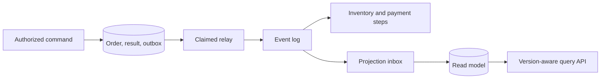

# Case 3 — Order Management, Step by Step

Finish [Payments](practice-payments.md), then complete this case before [Notifications](practice-notifications.md).
This expands interview-prep §1, §8, and §13 without claiming the case study is deployed in this lab.

## Step 1 — Requirements

### Q1. What does an accepted order mean, and which invariants matter?

??? question "Reveal answer"
    - **Separate durable order creation from inventory reservation, payment, and fulfillment.**
    - Clarify cancellation windows, partial fulfillment, stock ownership, payment timing, freshness, and whether users can see pending states.
    - Invariants: one logical order per operation identity, legal state transitions, no shipment before required payment/stock confirmation, and recoverable intent for every required next step.
    - Define latency/availability targets per command and read operation; a successful creation is not a completed purchase.
    - **Trade-off:** eventual workflows improve service independence but require visible intermediate states.
    - **Follow-up:** When may the client safely retry after losing the response?
    - **Takeaway:** Name the business acknowledgment before designing the transport.

## Step 2 — Capacity

### Q2. How do you size an order platform for 10k users and a 5× spike?

??? question "Reveal answer"
    - **Derive request rates and per-path work from explicit behavior assumptions.**
    - If each user submits one request every five seconds, average traffic is 2,000 RPS; 50 ms average response time implies about 100 in flight under stable conditions.
    - Separate browse reads from order writes, items per order, event amplification, retention, and projection work. A 5× spike does not guarantee latency remains flat.
    - Budget pool connections across normal replicas, surge, jobs, failover, and primary fallback. Track broker drain capacity as well as API throughput.
    - **Trade-off:** autoscaling helps only if downstream capacity exists; admission protects the interval before scale-out.
    - **Follow-up:** Which resource reaches its saturation knee first?
    - **Takeaway:** User count alone is not a capacity specification.

## Step 3 — API and model

### Q3. Which APIs and durable records establish ownership?

??? question "Reveal answer"
    - **Model an order aggregate with durable request identity and explicit workflow state.**
    - Creation accepts item references, quantities, and scoped idempotency identity; the server determines authorized prices/ownership. Reads expose status/version; cancellation is an authorized state transition.
    - Store orders, immutable line-item snapshots, versions, operation identity/result, outbox, workflow progress, and consumer inboxes as needed.
    - Unique constraints prevent duplicate operations; tenant/order and listing indexes follow actual access patterns. Money includes currency and rounding rules.
    - **Trade-off:** immutable item snapshots preserve purchase history while catalog details can change; avoid treating cached current price as the charged quote.
    - **Follow-up:** What happens if the same key arrives with different quantities?
    - **Takeaway:** The model must preserve commercial intent across retries.

## Step 4 — End-to-end baseline

### Q4. Walk through POST /orders and the first subsequent GET.

??? question "Reveal answer"
    - **Commit acceptance atomically, then advance fulfillment through recoverable local transitions.**
    - Authenticate/authorize, validate/admit, then atomically write order, durable idempotency result, and outbox. Return the created state or an explicit pending resource.
    - Relay confirmed events; inventory/payment handlers commit deduplication and state with their own next intent. Projection handlers update a query model and invalidate caches after commit.
    - GET may see pending projection; support a version token, bounded wait, or authoritative fallback rather than an unexplained 404.
    - **Trade-off:** broker outage can buffer intent only within finite database capacity; Redis outage must not collapse source reads.
    - **Follow-up:** Which record proves the order committed if the HTTP response was lost?
    - **Takeaway:** Distinguish command durability from read-model freshness.

## Step 5 — Architectural alternatives

### Q5. Modular monolith or services, shared model or CQRS, choreography or orchestration?

??? question "Reveal answer"
    - **Introduce distribution only where ownership, scale, or deployment benefits justify its failure costs.**
    - A modular monolith retains simple local transactions; separate services add independent ownership but require network contracts and partial-failure handling.
    - CQRS separates models, not necessarily processes; a projection helps expensive reads but adds rebuild and freshness obligations.
    - Choreography fits simple reactions; orchestration makes complex timers, compensation, and workflow status explicit through persisted state.
    - **Trade-off:** a coordinator need not own every business invariant; contexts still enforce local rules. More components are not evidence of senior design.
    - **Follow-up:** Which measured bottleneck justifies extracting the next service?
    - **Takeaway:** Defend the simplest architecture that meets the requirements.

## Step 6 — Concurrency and ordering

### Q6. How do duplicates, concurrent cancellation, and reordered events remain safe?

??? question "Reveal answer"
    - **Use operation identity and guarded aggregate transitions at durable boundaries.**
    - Commit an inbox identity with each effect; sequence aggregate events where every delta matters. Snapshot projections can use monotonic versions with an explicit equal-version policy.
    - Cancellation racing reservation/payment needs a state machine and compensating release/refund intent, not unrelated boolean flags.
    - A lease reduces duplicate relay claims but cannot prevent every late send; stale worker completion must check ownership generation.
    - **Trade-off:** strict per-order serialization limits local parallelism but avoids undefined transition order.
    - **Follow-up:** Can cancellation version 2 arrive before placement version 1 without losing required item data?
    - **Takeaway:** Broker ordering complements, not replaces, domain concurrency control.

## Step 7 — Failure and recovery

### Q7. What if the broker, a consumer, or payment provider fails mid-order?

??? question "Reveal answer"
    - **Persist recovery work and distinguish rejection, transient failure, and unknown outcome.**
    - Broker failure leaves committed outbox intent; consumer crash after DB commit permits safe redelivery. Poison events require bounded retries and audited DLT recovery.
    - Payment timeouts require reconciliation before another charge or compensation. Each required saga transition must publish durably, not fire-and-forget followed by acknowledgment.
    - Persist deadlines and recovery ownership; surface stuck/pending states and provide controlled repair workflows.
    - **Trade-off:** compensation is semantic undo and may fail; never imply a distributed rollback restores all external reality.
    - **Follow-up:** How does a failed compensation get detected and retried without duplicate refunds?
    - **Takeaway:** Recovery is part of the design's normal state machine.

## Step 8 — Scaling and regional ownership

### Q8. How do you scale beyond one primary or region without breaking orders?

??? question "Reveal answer"
    - **Remove unnecessary work before partitioning transactional ownership.**
    - Optimize queries, indexes, batching, transaction duration, and read offload; table partitioning does not distribute writes across machines by itself.
    - If sharding is required, choose an ownership key preserving common transactions and plan routing, resharding, uniqueness, and cross-shard workflows.
    - Active-passive regions require fenced promotion and known RPO/RTO; active-active needs explicit home ownership or conflict protocols, not generic last-write-wins for money or stock.
    - **Trade-off:** geographic replication trades freshness/latency/availability; caches and projections have separate consistency windows.
    - **Follow-up:** What happens to an acknowledged order not replicated before promotion?
    - **Takeaway:** Scaling must preserve who may authoritatively change an order.

## Step 9 — Read-model rebuild, security, and telemetry

### Q9. How do you rebuild a projection online and prove it is correct?

??? question "Reveal answer"
    - **Build a shadow model from a defined snapshot/stream boundary and validate before cutover.**
    - Replay retained history or use a consistent snapshot plus watermark; preserve deletes, identities, and overlap deduplication. Keep historical replay isolated from external side effects.
    - Compare counts, sampled records, versions, and business invariants; catch up, switch reads, and retain rollback capability. Zero lag alone does not prove equivalence.
    - Enforce tenant/owner authorization in both models and caches; observe outbox age, projection age, DLQ, unknown payments, and stuck workflow counts with bounded labels.
    - **Trade-off:** dual models increase resource demand and schema/version maintenance; retention limits can make replay alone insufficient.
    - **Follow-up:** How do you validate a corrected model when the old one is known to be wrong?
    - **Takeaway:** Projection rebuild is a controlled consistency migration.

## Step 10 — Verification and final review

### Q10. What evidence would qualify the complete order design?

??? question "Reveal answer"
    - **Reconcile accepted operations with durable final or explicitly unresolved outcomes.**
    - Test response loss, duplicate requests, out-of-order events, stale leases, consumer commit/ack crashes, payment ambiguity, replica lag, cache outage, and restore/failover.
    - Run representative read/write/skew workloads; report offered versus completed traffic, latency/error distributions, saturation, and backlog drain after failure.
    - State the guaranteed scope and retention of deduplication; define operational ownership of unresolved cases and compare simpler alternatives.
    - **Trade-off:** good API latency without correct fulfillment is insufficient; targets and external case-study measurements are not evidence from this lab.
    - **Follow-up:** Can you account for every accepted order after the experiment?
    - **Takeaway:** Complete the correctness and recovery argument before the next system.

## Related

- [Practice sequence](practice.md)
- [Concepts](concepts.md)
- [Interview Questions](questions.md)
- [Outbox and saga practice](../distributed-data-patterns/practice.md)
- [Next: Notifications](practice-notifications.md)
