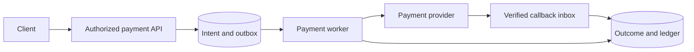

# Case 2 — Payments, Step by Step

Complete [URL Shortener](practice-url-shortener.md) first; finish this case before
[Order Management](practice-orders.md). This extends interview-prep §13's payment scenario.

## Step 1 — Scope and invariants

### Q1. Which guarantees must a payment service define before choosing a queue?

??? question "Reveal answer"
    - **Define one logical charge, durable accounting, and explicit unknown outcomes.**
    - Clarify authorization versus capture, refunds, partial payments, currencies, provider contracts, settlement, and regulatory boundaries.
    - Invariants include no duplicate logical debit, balanced ledger entries, authorized ownership, and traceable provider references.
    - A timeout is not proof of failure; a customer-facing pending state is preferable to guessing and creating another charge.
    - **Trade-off:** asynchronous acceptance improves availability but is not payment success. Avoid promising universal exactly-once behavior across an external provider.
    - **Follow-up:** When may the order ship, and what constitutes final payment confirmation?
    - **Takeaway:** Money movement requires an outcome model, not just an endpoint.

## Step 2 — Capacity and budgets

### Q2. What capacity matters beyond payments per second?

??? question "Reveal answer"
    - **Budget provider limits, outstanding unknown operations, storage, and reconciliation capacity.**
    - For an illustrative 200 operations/s and 0.5 s mean provider latency, Little's law suggests 100 average in-flight calls before headroom and retries.
    - Peak bursts, callback volume, provider quota, connection pools, and slow settlement determine backlog and recovery time.
    - Keep a deadline for the request distinct from the longer durable workflow deadline. Do not allocate one open DB connection per provider wait.
    - **Trade-off:** additional concurrency may increase provider throttling without increasing completed payments.
    - **Follow-up:** Can reconciliation catch up after a provider outage while new traffic continues?
    - **Takeaway:** Capacity includes unresolved financial work.

## Step 3 — API and durable model

### Q3. Which identities and records belong in the model?

??? question "Reveal answer"
    - **Separate client request, payment intent, provider attempt, and ledger transaction identities.**
    - Creation accepts amount/currency, authorized business reference, and scoped idempotency key; status exposes intent state, not raw provider internals. Refunds have their own operation identity.
    - Store intent, attempts/provider references, request fingerprint/result, ledger headers/entries, inbox, and outbox. Unique constraints prevent duplicate logical operations.
    - Ledger entries are immutable corrections/reversals, not ad hoc balance overwrites; enforce balanced postings per currency through a controlled transaction protocol.
    - **Trade-off:** provider retries can map to one intent but require attempt audit; one generic status field is often too coarse.
    - **Follow-up:** How do you correlate a late callback when the original HTTP response was lost?
    - **Takeaway:** Financial identity must survive retries and crashes.

## Step 4 — Baseline flow

### Q4. How does a payment proceed without holding a transaction across HTTP?

??? question "Reveal answer"
    - **Persist intent, execute the provider operation outside the transaction, then record the result durably.**
    - Validate and authorize; atomically reserve identity plus intent and outbox command. A worker calls the provider with stable idempotency identity and a bounded client deadline.
    - Record verified outcome, ledger transition, and next event in a short transaction. Deduplicate callbacks and worker results against the same intent.
    - Expose pending/unknown status if the synchronous request budget expires; retain recovery ownership after the client disconnects.
    - **Trade-off:** extra state and async latency buy recoverable failure boundaries; local database atomicity cannot include an ordinary external provider call.
    - **Follow-up:** What happens if the worker crashes after the provider accepts but before local completion?
    - **Takeaway:** Recovery bridges the external commit gap.

## Step 5 — Alternatives

### Q5. Synchronous provider calls, asynchronous workers, or 2PC?

??? question "Reveal answer"
    - **Choose an honest latency/outcome contract; do not assume the provider participates in distributed transactions.**
    - A synchronous path offers immediate results when fast, but still needs durable intent, idempotency, and recovery after timeout.
    - Workers isolate load and survive request termination; callers receive a pending resource and query or subscribe for completion.
    - 2PC is not available for a typical HTTP PSP and cannot solve arbitrary side effects; local ledger/outbox atomicity remains valuable.
    - **Trade-off:** queues add delay and operations; synchronous waiting adds request resource pressure. Both need reconciliation.
    - **Follow-up:** Which operations genuinely need an immediate definitive answer?
    - **Takeaway:** Async changes coordination, not financial correctness obligations.

## Step 6 — Idempotency and concurrency

### Q6. How are double-clicks, webhook duplicates, and concurrent refunds controlled?

??? question "Reveal answer"
    - **Enforce operation uniqueness and legal state transitions in durable storage.**
    - Scope request keys to the verified principal/business operation and reject mismatched fingerprints; save recoverable results atomically with local effects.
    - Use provider idempotency identity for external attempts; authenticate callbacks and deduplicate event identity in the same transaction as application.
    - Lock/version the relevant payment/refund aggregate so concurrent partial refunds cannot exceed captured amount. A Redis lease is not the source of truth.
    - **Trade-off:** provider dedup windows may expire before your recovery horizon; query provider history before attempting an old unknown operation again.
    - **Follow-up:** How is a callback racing a worker response applied only once?
    - **Takeaway:** Deduplication must protect each independent effect boundary.

## Step 7 — Ambiguous failure and compensation

### Q7. The provider times out after receiving the request: should you retry or refund?

??? question "Reveal answer"
    - **Persist UNKNOWN and reconcile with the original operation identity.**
    - A client deadline only stops waiting; the provider may have charged successfully. Query status or retry under the provider's documented idempotency contract.
    - Apply a confirmed late outcome through guarded transitions. Refund is a new financial operation, not a rollback, and must itself be idempotent and reconcilable.
    - Escalate unresolved cases with an audit trail rather than indefinitely creating new attempts or asserting failure.
    - **Trade-off:** customers may wait longer, but premature retry/refund can move money incorrectly.
    - **Follow-up:** What happens if cancellation is requested while outcome remains unknown?
    - **Takeaway:** Unknown outcome requires evidence, not optimistic guessing.

## Step 8 — Scale and isolation

### Q8. How do you scale without breaking ledger invariants?

??? question "Reveal answer"
    - **Partition work by financial ownership and serialize only the necessary invariants.**
    - Apply per-provider quotas, bounded workers, circuit breakers, and priority for reconciliation; separate slow providers into bulkheads.
    - Shard by a key that keeps required account/intent operations local where possible. Cross-shard balanced transfers require a deliberate protocol and recovery, not independent writes.
    - Rebuild balance projections from the authoritative ledger with versioned events; do not use a stale cache to authorize spending without an explicit reservation model.
    - **Trade-off:** append-only history improves audit but grows storage; snapshots accelerate reads without replacing source history.
    - **Follow-up:** What bottleneck remains when one merchant generates most payments?
    - **Takeaway:** Scale throughput without distributing an invariant accidentally.

## Step 9 — Security and operations

### Q9. Which security and reliability signals are payment-specific?

??? question "Reveal answer"
    - **Protect credentials and financial data while measuring outcomes, not only HTTP success.**
    - Use provider tokenization and minimize sensitive card data; enforce ownership, least privilege, signed/verified callbacks, and operator audit. Compliance scope needs specialist review.
    - Track intent age by state, unknown outcomes, duplicate suppression, provider errors, reconciliation mismatch, and ledger imbalance alarms with bounded labels.
    - Store traceable references in protected logs, not full tokens/payloads; test secret rotation and incident access.
    - **Trade-off:** detailed audit retention has privacy and cost obligations; keep business audit separate from sampled traces.
    - **Follow-up:** Which alert catches a successful API that never reaches settled payment?
    - **Takeaway:** Financial correctness needs its own telemetry.

## Step 10 — Verification and final defense

### Q10. Which tests would make your payment guarantees credible?

??? question "Reveal answer"
    - **Exercise every commit gap and reconcile against independent provider evidence.**
    - Test lost responses, duplicate requests, fingerprint mismatch, concurrent refunds, callback reordering, worker death after provider acceptance, and idempotency expiry.
    - Verify local accounting invariants and provider totals, restore backups, and rehearse settlement mismatch resolution without issuing uncontrolled live charges.
    - Compare synchronous and queued approaches using latency, outstanding unknowns, provider quota, operations burden, and recovery time.
    - **Trade-off:** mocks test logic but not real provider contracts; use approved sandbox and contractual integration tests, never unapproved real payments.
    - **Follow-up:** What can the design prove locally, and what does it assume about the provider?
    - **Takeaway:** End the design with explicit guarantees and bounded assumptions.

## Related

- [Practice sequence](practice.md)
- [Concepts](concepts.md)
- [Interview Questions](questions.md)
- [API idempotency](../rest-api/practice.md)
- [Next: Order Management](practice-orders.md)
