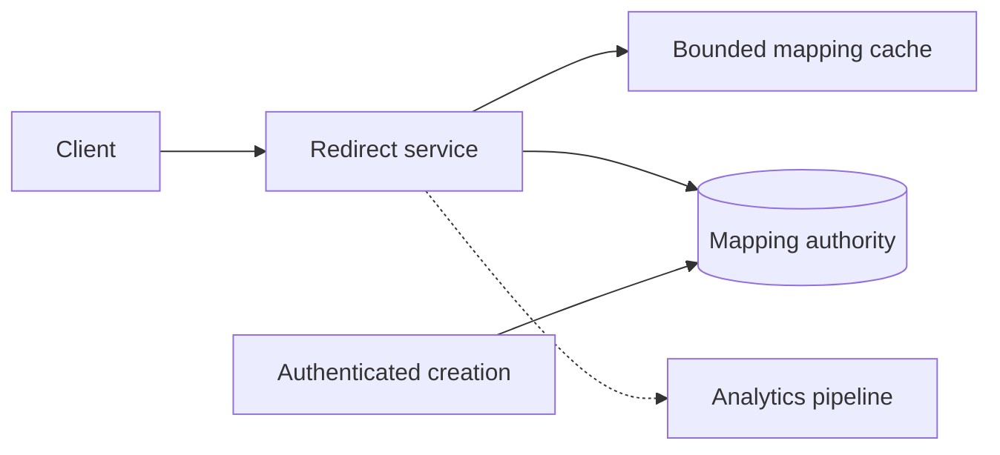

# Case 1 — URL Shortener, Step by Step

Finish this case before [Case 2 — Payments](practice-payments.md). Answers are collapsed;
explain each decision aloud before revealing. Numbers are interview assumptions, not measured capacity.

## Step 1 — Scope and invariants

### Q1. What must you clarify before drawing a URL shortener?

??? question "Reveal answer"
    - **Separate redirect availability from link-management and analytics requirements.**
    - Clarify public versus private links, custom aliases, expiry, edits, deletion, abuse handling, geography, and whether click analytics may lose events.
    - Define invariants: one active owner per code, no redirect after authoritative revocation, and explicit limits on destination schemes and size.
    - Ask where sub-10 ms latency is measured; global client latency includes network distance and cannot be promised from server timing alone.
    - **Trade-off:** immutable public links permit aggressive caching; editable or access-controlled links require stronger revocation behavior.
    - **Follow-up:** Is a short code a public identifier or an access credential?
    - **Takeaway:** The redirect contract determines the architecture.

## Step 2 — Capacity

### Q2. What do 100 million creations and 10 billion redirects per month imply?

??? question "Reveal answer"
    - **Estimate averages first, then specify peak factors, skew, and retention separately.**
    - With a 30-day month: writes ≈ 38.6/s and redirects ≈ 3,858/s. A 10× peak assumption means roughly 386 writes/s and 38,580 redirects/s.
    - At 1 KB per mapping, 100 million writes add about 100 GB/month before indexes, replication, backups, and analytics.
    - Cache memory depends on **distinct active mappings** and entry overhead, not simply a percentage of click count. One viral link can generate millions of clicks.
    - **Trade-off:** calculate bandwidth and event volume independently; analytics may cost more than redirect lookup.
    - **Follow-up:** What happens when one code receives half the traffic?
    - **Takeaway:** Request volume and working-set size are different quantities.

## Step 3 — API and data model

### Q3. What are the minimal APIs, rows, and indexes?

??? question "Reveal answer"
    - **Keep mapping ownership and redirect lookup explicit.**
    - Creation accepts destination, optional alias, expiry, and an idempotency key; authenticated management updates or revokes an owned mapping; lookup returns Location or a documented missing/expired result.
    - Store code, owner ID, destination, state, expiry, version, and creation time; enforce a unique code index. Add an owner/time index only for actual management queries.
    - Validate URL scheme and length; private links require authorization independent of code entropy. Store analytics outside the mapping row to avoid hot-counter updates.
    - **Trade-off:** target deduplication may save rows but changes privacy, ownership, and expiry semantics; do not silently make every identical URL share one code.
    - **Follow-up:** Does repeating creation after a lost response create another code?
    - **Takeaway:** Design the write identity as carefully as the read key.

## Step 4 — Baseline architecture

### Q4. What is the simplest credible end-to-end design?

??? question "Reveal answer"
    - **Begin with stateless services and a durable indexed mapping store.**
    - Creation validates and authorizes, inserts a unique mapping, and returns only after commit. Redirect resolves code, validates state/expiry, and returns the destination.
    - Add bounded local/shared caches for repeated public lookups and asynchronous analytics with an explicit loss policy.
    - Do not put an unavailable analytics dependency on the redirect critical path unless every click is contractually durable.
    - **Trade-off:** one relational primary is a reasonable baseline at these average write rates; distributed storage should answer a demonstrated limit.
    - **Follow-up:** Which component is authoritative when cache and database disagree?
    - **Takeaway:** Establish correct flows before adding scale infrastructure.

## Step 5 — Identifier alternatives

### Q5. Random code, truncated hash, or Base62 sequence?

??? question "Reveal answer"
    - **Separate uniqueness, space size, and unpredictability.**
    - Base62 is an encoding, not encryption; sequential IDs remain enumerable. Seven characters provide 62^7 ≈ 3.52 trillion combinations, not an unlimited namespace.
    - Random codes need unique-constraint enforcement and collision retry; occupancy and the birthday effect matter long before the namespace is full.
    - Hash truncation also collides and ties generation to canonicalization. Allocated ranges avoid a per-request coordinator but need durable range ownership and crash policy.
    - **Trade-off:** longer random codes reduce guessing/collisions at usability cost; custom aliases need atomic reservation and abuse policy.
    - **Follow-up:** What guarantees that two regions cannot claim the same custom alias?
    - **Takeaway:** An opaque-looking identifier is not authorization.

## Step 6 — Redirect and cache semantics

### Q6. Should redirects use 301 or 302, and how is cache freshness controlled?

??? question "Reveal answer"
    - **Choose explicit HTTP caching policy based on editability and analytics needs.**
    - Permanent redirects can be reused beyond your service; temporary redirects can also be cached under appropriate headers, so '302 always reaches the origin' is false.
    - Set Cache-Control deliberately and cap cache lifetime at link expiry. Mutable mappings need versioned invalidation and a defined revocation window across local, shared, CDN, and browser caches.
    - Analytics for CDN/browser hits requires an edge mechanism or acceptance that origin counts are incomplete.
    - **Trade-off:** maximum edge caching improves availability and latency but weakens immediate revocation and origin-level measurement.
    - **Follow-up:** How would an emergency malicious-link takedown reach every cached layer?
    - **Takeaway:** Status codes do not replace a caching contract.

## Step 7 — Concurrency and correctness

### Q7. How do custom alias collisions and stale fills remain safe?

??? question "Reveal answer"
    - **Use the durable store for alias uniqueness and versions for mutable mapping coherence.**
    - Concurrent alias requests race on one unique key; return a documented conflict instead of SELECT-then-INSERT. Scope management authorization to the owner.
    - A reader can fill an old destination after deletion; invalidation alone does not fence that reader. Retain a version/generation where the freshness contract requires it.
    - Revoked codes should not be casually reused: old bookmarks, caches, and delayed events may refer to the previous destination.
    - **Trade-off:** never reusing codes consumes namespace but simplifies safety; reuse requires a quarantine and generation-aware contract.
    - **Follow-up:** Can a missing-entry negative cache delay a newly created link?
    - **Takeaway:** Link lifecycle extends beyond row insertion.

## Step 8 — Failure recovery

### Q8. What happens when Redis, the mapping store, or analytics is unavailable?

??? question "Reveal answer"
    - **Degrade optional work without silently changing link-safety guarantees.**
    - Redis failure can fall back through a breaker and bounded DB admission; local valid entries may keep serving. An unknown or revoked mapping must not be fabricated.
    - Store outage may permit cached public links within the allowed stale window while management writes fail; access-controlled/revoked links need stricter policy.
    - Analytics failure needs bounded buffering or an explicit drop counter; a memory queue is not durable acceptance.
    - **Trade-off:** serving stale improves availability but cannot claim immediate deletion consistency. Test failover and unknown creation outcomes with idempotency.
    - **Follow-up:** How do you protect the DB when every cached key expires during an outage?
    - **Takeaway:** Define availability separately for reads, writes, and analytics.

## Step 9 — Scaling and security

### Q9. What changes for viral links, abuse, or multiple regions?

??? question "Reveal answer"
    - **Use edge locality and admission first, while retaining authoritative ownership rules.**
    - A viral read key can be replicated in cache/CDN; analytics must partition and aggregate without one hot counter. Sharding by code distributes storage but not one key's traffic.
    - Rate-limit creation and random-code scans; validate destination schemes. Preview/unfurl fetchers need SSRF protection; a simple redirect does not itself require server-side fetching.
    - Region-local read replicas/caches can serve immutable links; custom alias reservation and edits need explicit write authority and conflict handling.
    - **Trade-off:** global strong writes add coordination; asynchronous replication creates a visible propagation window.
    - **Follow-up:** What will a user see immediately after creating a link in another region?
    - **Takeaway:** Read replication is easier than global lifecycle consistency.

## Step 10 — Validation and decision review

### Q10. How do you prove this design is ready, and when would you redesign it?

??? question "Reveal answer"
    - **Verify redirect outcomes, freshness, abuse controls, and tail latency under representative skew.**
    - Measure offered/completed redirects, cache/source latency, incorrect/expired redirects, creation conflicts, analytics loss, and per-key hot spots with bounded metric labels.
    - Test collisions, lost creation responses, expiry during reads, revoked-link stale fills, cache outage, and restore from backup.
    - Compare relational baseline versus distributed key-value storage using actual write/read scale, geographic latency, and operational cost—not brand preference.
    - **Trade-off:** a fast cached benchmark does not qualify cold reads or emergency revocation; state what remains unproven.
    - **Follow-up:** Can you explain the complete design in two minutes without naming every technology?
    - **Takeaway:** Finish the failure and evidence story before moving on.

## Related

- [Practice sequence](practice.md)
- [Concepts](concepts.md)
- [Interview Questions](questions.md)
- [Next: Payments](practice-payments.md)
